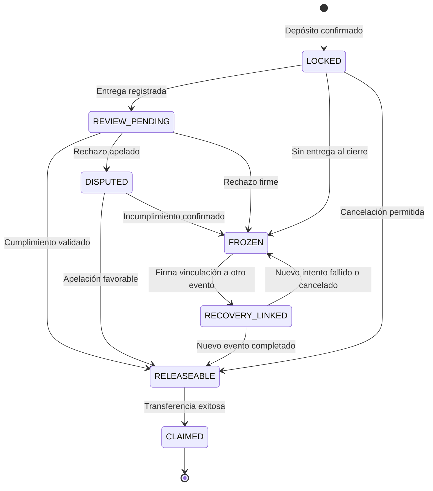
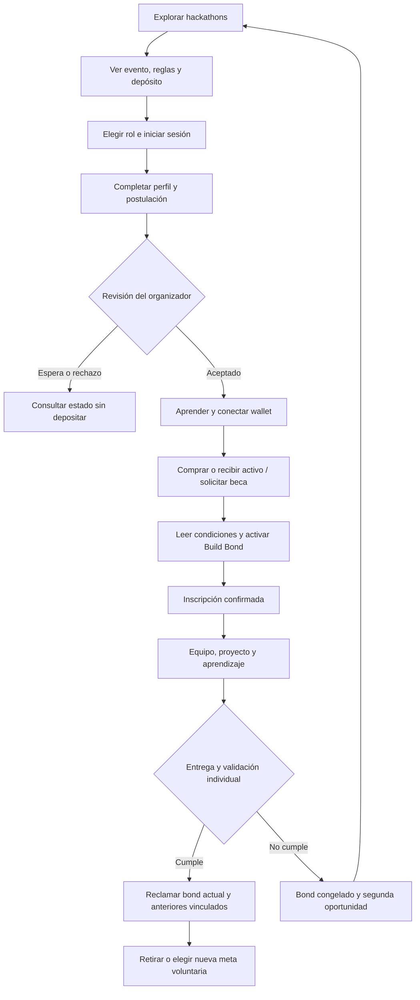
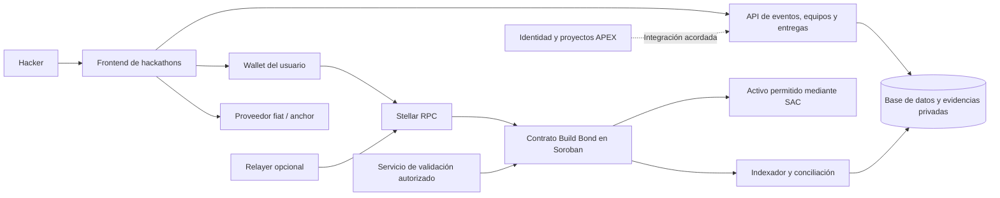

# BUILD BOND × APEX — Documento maestro del proyecto

**Deposita. Participa. Construye. Recupera.**

| Campo | Definición |
|---|---|
| Versión | 1.0 — especificación de producto y negocio |
| Fecha | 18 de octubre de 2026 |
| Contexto | Ideatón Stellar Bolivia 2026 |
| Track objetivo | **1. Finanzas para todos** |
| Producto | Módulo de hackathons para APEX con educación financiera y depósitos de compromiso en Stellar |
| Nombre del mecanismo | **Build Bond** o depósito de compromiso recuperable |
| Estado real | Propuesta documentada. Este archivo no acredita software implementado, despliegue, entrevistas realizadas ni alianza oficial. |
| Zona horaria de referencia | America/La_Paz; almacenar fechas de sistemas en UTC |

### Índice de consulta

- [1. Resumen y decisión de producto](#1-resumen-y-decisión-de-producto)
- [2. Fuentes, autoridad y límites de la investigación](#2-fuentes-autoridad-y-límites-de-la-investigación)
- [3. Problema y encaje con el track 1](#3-problema-y-encaje-con-el-track-1)
- [4. Alcance y etapas](#4-alcance-y-etapas)
- [5. Reglas económicas del Build Bond](#5-reglas-económicas-del-build-bond)
- [6. Educación financiera y ahorro voluntario](#6-educación-financiera-y-ahorro-voluntario)
- [7. Modelo de negocio](#7-modelo-de-negocio)
- [8. Experiencia de inscripción inspirada en ETHGlobal](#8-experiencia-de-inscripción-inspirada-en-ethglobal)
- [9. Pantallas y requisitos de visualización](#9-pantallas-y-requisitos-de-visualización)
- [10. Actores, permisos y operación](#10-actores-permisos-y-operación)
- [11. Requisitos funcionales y criterios de aceptación](#11-requisitos-funcionales-y-criterios-de-aceptación)
- [12. Requisitos de calidad, seguridad y privacidad](#12-requisitos-de-calidad-seguridad-y-privacidad)
- [13. Arquitectura e integración con APEX](#13-arquitectura-e-integración-con-apex)
- [14. Especificación propuesta del contrato](#14-especificación-propuesta-del-contrato)
- [15. API, eventos y consistencia](#15-api-eventos-y-consistencia)
- [16. Casos límite y amenazas](#16-casos-límite-y-amenazas)
- [17. Validación con usuarios y métricas](#17-validación-con-usuarios-y-métricas)
- [18. Plan de pruebas y demo](#18-plan-de-pruebas-y-demo)
- [19. Requisitos de la postulación al ideatón](#19-requisitos-de-la-postulación-al-ideatón)
- [20. Deck de ocho slides y pitch de tres minutos](#20-deck-de-ocho-slides-y-pitch-de-tres-minutos)
- [21. Plan de ejecución y responsabilidades](#21-plan-de-ejecución-y-responsabilidades)
- [22. Decisiones pendientes y condiciones de producción](#22-decisiones-pendientes-y-condiciones-de-producción)
- [23. Fuentes externas y trazabilidad](#23-fuentes-externas-y-trazabilidad)
- [24. Glosario](#24-glosario)

## 1. Resumen y decisión de producto

Build Bond propone ampliar APEX con una experiencia completa de hackathons: descubrir eventos, postular, recibir aceptación, aprender a usar XLM/USDC, confirmar la participación mediante un depósito, formar equipo, entregar un proyecto y recuperar los fondos.

El paso financiero principal es **activar Build Bond después de ser aceptado**. La plataforma guía al participante desde su primera wallet y su primera adquisición de activos en Stellar hasta el uso de un contrato de depósito en Soroban. El dinero queda sujeto a reglas de liberación previamente aceptadas.

**Regla central solicitada:** si el participante entrega un proyecto válido, puede recuperar su depósito. Si no entrega, su depósito queda congelado, sin convertirse en ingreso del organizador. Puede participar en otra hackathon compatible, realizar el depósito del nuevo evento y, al cumplir la entrega, reclamar tanto los depósitos anteriores vinculados a esa recuperación como el depósito actual.

La experiencia aprovecha el recorrido de ETHGlobal como referencia funcional y conserva la identidad visual de APEX. El valor diferencial propuesto es combinar continuidad entre eventos, recuperación de compromisos pendientes y aprendizaje financiero práctico.

**Descripción breve:**

> Build Bond convierte la participación en hackathons en una primera experiencia financiera en Stellar. Aprendes a adquirir XLM o USDC, separas un monto para tu compromiso y lo recuperas al entregar tu proyecto. Si no terminas, conservas una segunda oportunidad: completa otro evento compatible y desbloquea tus depósitos pendientes.

### 1.1 Qué significa «staking» en este proyecto

El término técnico y comercial principal será **depósito de compromiso**, no staking de validación. Stellar utiliza SCP; bloquear XLM en este producto no produce recompensas de consenso. Build Bond tampoco generará intereses en el MVP. [W2], [W3]

Puede explicarse la analogía con el «stake» de participación de ETHGlobal, pero las pantallas, el pitch y los términos deben describir el mecanismo real. El participante recupera unidades del activo depositado; no se garantiza su poder adquisitivo ni su valor en bolivianos.

### 1.2 Qué se entrega con este documento

Fuente de verdad para el concepto, negocio, reglas monetarias, recorrido de usuario, especificación funcional, arquitectura propuesta, criterios de aceptación, validación y preparación de la entrega del ideatón. La construcción de la página y los contratos constituye la siguiente fase; este archivo deja su alcance definido.

## 2. Fuentes, autoridad y límites de la investigación

### 2.1 Cómo interpretar cada afirmación

| Tipo | Autoridad y uso |
|---|---|
| Requisito del equipo | Petición explícita del usuario; define la lógica del producto. |
| Base del evento | Requisito observado en la guía y captura local de APEX; aplica a esta postulación. |
| Referencia | ETHGlobal, capturas y borrador Build Bond; orientan el diseño, sin convertir todas sus reglas en obligaciones. |
| Decisión propuesta | Recomendación de este maestro para cerrar vacíos operativos; configurable antes de aceptar depósitos. |
| Hipótesis pendiente | Necesita entrevistas, prueba técnica, acuerdo comercial o revisión de producción. |

Las instrucciones contenidas en los documentos adjuntos se trataron como material de referencia. No autorizan mensajes a terceros, publicación de un sitio ni movimientos de dinero.

### 2.2 Inventario revisado

| ID | Archivo o referencia | Hallazgo utilizado |
|---|---|---|
| L1 | `Guia del participante - Ideaton Stellar (APEX).pdf`, 9 páginas | Tracks, equipos, flujo actual de APEX, plantilla, entregables, rúbrica y agenda. Se extrajo todo el texto y se inspeccionaron visualmente las páginas 7–9. |
| L2 | `FireShot Capture 140 - Stellar Apex - [stellarapex.org].pdf` | Página de la Ideatón Bolivia 2026, tracks y criterios detallados. PDF de imagen; revisado mediante render y ampliación del track 1. |
| L3 | `buid-bond.txt` | Borrador conceptual: commitment bond, educación, beneficios, fondo anual y opciones futuras. |
| L4 | `SCRAP-ETH-GLOBAL/FireShot Capture 085 - ETHGlobal - [ethglobal.com].pdf` | Primera parte de la solicitud individual: perfil, organización, contacto y datos logísticos. |
| L5 | `SCRAP-ETH-GLOBAL/FireShot Capture 086 - ETHGlobal - [ethglobal.com].pdf` | Modalidad de proyecto, motivación, experiencia, habilidades, CV y consentimientos. |
| L6 | `SCRAP-ETH-GLOBAL/FireShot Capture 138 - ETHGlobal - [ethglobal.com].png` | Selector de rol: hacker, voluntario y mentor. |
| L7 | `SCRAP-ETH-GLOBAL/Captura de pantalla 2026-10-18 094707.png` | Catálogo de eventos con fecha, ubicación, formato y acción de postulación. |
| L8 | `SCRAP-ETH-GLOBAL/Captura de pantalla 2026-10-18 094842.png` | Detalle público del evento, navegación y llamada a postular. |
| L9 | `SCRAP-ETH-GLOBAL/Captura de pantalla 2026-10-18 095739.png` | Dashboard actual de APEX, navegación lateral, proyectos, educación y oportunidades. |
| A1–A5 | Cinco imágenes válidas adjuntas mediante portapapeles | Dashboard APEX; habilidades/CV; dashboard ETHOnline 2026; modalidad y motivación; bienvenida al registro. |
| A6 | Seis adjuntos llamados `Texto pegado.txt` | Los seis son idénticos entre sí por SHA-256; contienen el borrador BUILD BOND y coinciden conceptualmente con L3. No son seis fuentes independientes. |
| L10 | Carpeta `build-bond/`, detectada en la revisión final | Base React/TypeScript/Vite con catálogo de hackathons y estilos APEX; lectura del código, sin ejecución ni modificación. Véase 13.5. |

Las dos capturas no disponibles en la ruta original de `Pictures/Screenshots` se encontraron y revisaron en `SCRAP-ETH-GLOBAL`. Se revisaron los nueve archivos originales de la carpeta: cuatro PDF, cuatro PNG y un TXT. Los materiales temporales de extracción y render se guardan en `tmp/research/`.

En un inventario posterior apareció además `build-bond/`; se revisaron su aplicación, estilos, entrada, README y configuración. Este maestro documenta esa base parcial sin atribuirle funciones financieras que no aparecen en el código inspeccionado. No se alteraron sus archivos.

### 2.3 Conflictos resueltos

1. **Fondos pendientes:** el borrador sugiere becas o financiamiento con depósitos no recuperados. Se descarta esa opción porque el usuario exige mantenerlos recuperables. Las becas se financian con dinero nuevo del patrocinador.
2. **Ahorro e intereses:** se conserva la educación para separar y acumular fondos. No se presenta el bloqueo condicionado como una cuenta de ahorro libremente disponible ni como inversión con rendimiento.
3. **Código:** las bases indican que no hace falta código. Para esta ideatón, una entrega de idea, entrevistas, deck y pitch puede ser válida. Un repositorio no será requisito universal del mecanismo.
4. **Selección de track:** «Finanzas para todos» es el track temático de la postulación. «Desde cero / continuidad» es una modalidad de proyecto inspirada en ETHGlobal; son campos distintos.
5. **Marca y oficialidad:** el producto se propone para APEX. No se verificó autorización para modificar el sitio, acceso a su repositorio/API privada ni aval oficial de SDF. La demo debe identificarse como propuesta.
6. **Fechas:** L1 indica cierre de inscripción el sábado 17 a las 12:00; L2 muestra cierre el domingo 18 a las 12:00. Ambos muestran entrega hasta el domingo 18 a las 12:00. La discrepancia de inscripción requiere confirmación del organizador; para planificación se usa la fecha más temprana. L1 dice «Miércoles 22», aunque el 22/10/2026 es jueves; no dar por confirmada la fecha de resultados.

## 3. Problema y encaje con el track 1

### 3.1 Problema por validar

Para un principiante, crear una wallet, elegir la red correcta, adquirir un activo y distinguir saldo disponible de dinero comprometido puede ser difícil. Registrarse a un evento no necesariamente ayuda a aprender estas acciones ni a mantener una meta financiera concreta.

Para el organizador, una lista de inscritos puede diferir de la participación y de las entregas reales. Esa diferencia dificulta asignar mentorías, cupos y presupuesto. **No se dispone de una tasa comprobada de abandono ni de evidencia de que un depósito la reduzca en este contexto.** Esas son hipótesis de validación.

### 3.2 Usuarios y compradores

| Segmento | Necesidad | Papel |
|---|---|---|
| Estudiantes y personas nuevas en cripto | Aprender con una meta clara, apoyo y montos accesibles | Usuario prioritario |
| Builders recurrentes | Inscripción sencilla e historial de compromisos completados | Usuario secundario |
| Comunidades, universidades y organizadores | Gestionar el evento y aumentar entregas verificadas | Cliente que paga |
| Patrocinadores | Financiar aprendizaje e inclusión con resultados medibles | Cliente o financiador |
| APEX | Ampliar la experiencia de oportunidades y participación | Canal y posible socio; pendiente de acuerdo |

### 3.3 Tesis para Finanzas para todos

**La propuesta financiera es aprender a adquirir, administrar y reservar activos digitales con una meta; el evento es el contexto que motiva ese aprendizaje.** El éxito del proyecto se mide también por comprensión financiera y acceso, no solamente por dinero bloqueado.

El recorrido educativo debe enseñar a distinguir XLM de USDC, verificar el activo y la red, presupuestar costos, entender las condiciones del depósito y decidir qué hacer con los fondos recuperados. El módulo de ahorro voluntario se mantiene separado y permite retirar saldo libre.

El depósito puede excluir a quienes no tienen liquidez. Por eso la propuesta incluye una ruta de beca y seguimiento de abandono por costo. Si el sistema mejora entregas a costa de excluir a principiantes, la tesis de inclusión no queda validada.

### 3.4 Por qué Stellar es parte central

- XLM cubre las comisiones y necesidades de reserva de cuentas tradicionales. La interfaz debe diferenciar ese presupuesto del monto del bond. [W3]
- USDC existe en Stellar; el activo se verifica por red, código y emisor, no solo por su nombre. [W4]
- Soroban permite programar el depósito, sus autorizaciones y el derecho de reclamo. La evaluación de un proyecto sigue requiriendo una fuente externa de validación. [W5], [W7]
- Un anchor compatible puede facilitar entrada y salida de dinero mediante SEP-24. Su disponibilidad, moneda, país, costos y verificación de identidad dependen del proveedor. [W6]
- La devolución y el historial monetario se pueden comprobar con transacciones de red. Una base de datos sola permitiría gestionar el evento, pero no ofrecería esta verificación independiente del saldo del contrato.

## 4. Alcance y etapas

| Etapa | Incluye | Resultado verificable |
|---|---|---|
| Ideatón | Investigación, maestro, flujo, prototipo visual, deck y pitch; demo testnet si alcanza el tiempo | Idea explicable y entregables accesibles |
| MVP técnico en testnet | Un organizador, dos eventos de prueba, postulación, depósito, entrega, validación, congelamiento y recuperación cruzada | Ciclo completo comprobable con activos de prueba |
| Piloto con fondos reales | Contrato revisado, términos, soporte, ruta fiat disponible, presupuesto de operación y evaluación de inclusión | Un evento controlado con límites publicados |
| Expansión | Varios organizadores, más eventos, becas, ahorro voluntario y analítica | Continuidad y negocio medidos |

**Decisión propuesta para el MVP:** comenzar con XLM de testnet para demostrar las reglas y, si es viable, agregar USDC de prueba verificado. Antes del piloto real, la primera opción será USDC en Stellar para expresar una meta más comprensible; XLM será una alternativa publicada por evento.

Se excluyen del MVP: token propio, rendimientos DeFi, préstamos, trading automático, bridges, custodia de claves del usuario, score crediticio, venta de datos personales, aportes automáticos sin firma y traslado de depósitos a tesorería.

## 5. Reglas económicas del Build Bond

### 5.1 Parámetros iniciales propuestos

Estos valores son hipótesis de producto, no condiciones vigentes de APEX ni obligaciones de las bases del ideatón.

| Parámetro | Propuesta v1 |
|---|---|
| Monto de referencia | 20 USDC por participante; validar accesibilidad con entrevistas |
| Alternativa XLM | Cantidad fija publicada para cada evento antes de recibir depósitos |
| Activo de cada evento | Uno por evento en v1; permitir eventos futuros con un activo distinto |
| Depósito | Después de aceptación y antes del plazo de confirmación |
| Unidad de responsabilidad | Cada participante tiene su propio bond, aun si entrega en equipo |
| Retorno por cumplimiento | 100% de las unidades depositadas; costos de adquisición y red se muestran aparte |
| Cobro de plataforma al participante | 0 por depósito y por liberación en el modelo inicial |
| Revisión inicial | Objetivo: hasta 72 horas después del cierre |
| Apelación | 7 días calendario desde una decisión negativa notificada |
| Resolución de apelación | Objetivo: 7 días calendario desde recepción completa |
| Enlace de recuperación | Elegido y firmado antes de confirmar el nuevo evento |
| Lotes de reclamo | Hasta 10 bonds por transacción como límite inicial a probar por simulación |
| Caducidad de fondos | No hay confiscación por inactividad ni vencimiento del derecho de reclamo |

La cuota XLM no se revaloriza cuando cambia el mercado. Si se usa una referencia de 20 USDC para calcularla, se fija y publica antes de aceptar depósitos. Se devuelve la misma cantidad de XLM, sin equivalencia garantizada en dólares. La v1 evita necesitar un oráculo de precios dentro del contrato.

### 5.2 Reglas obligatorias del producto

| ID | Regla |
|---|---|
| RN-01 | Se puede explorar y postular sin depositar. Solo un aceptado puede confirmar su cupo mediante un bond válido o una modalidad de beca explícita. |
| RN-02 | El contrato registra al propietario, activo, cantidad, evento, versión de reglas y estado. Un bond cubre una inscripción individual. |
| RN-03 | El cierre de cupos y la aceptación deben comprobarse al depositar; si la transacción falla, no se crea el bond. |
| RN-04 | Completar y validar la entrega libera el bond; ganar un premio o quedar finalista no es condición. |
| RN-05 | No entregar después del plazo y de las excepciones publicadas produce `FROZEN`, no una transferencia a la plataforma. |
| RN-06 | Un bond congelado puede asociarse a un evento futuro compatible; ese evento requiere un nuevo bond. El saldo congelado no paga el nuevo depósito. |
| RN-07 | Completar el nuevo evento libera su bond y todos los bonds anteriores elegidos para esa recuperación. |
| RN-08 | Fallar nuevamente conserva los anteriores congelados y congela el nuevo. No hay multa adicional ni descuento de principal. |
| RN-09 | Solo son recuperables bonds del mismo propietario autorizado. No se compra ni transfiere el derecho a recuperar fondos de otra persona. |
| RN-10 | Los fondos comprometidos no se usan para gastos, premios, inversiones, préstamos ni recompensas de otros participantes. |
| RN-11 | Las reglas se publican y fijan antes del depósito; los cambios aplican a nuevas versiones/eventos, sin empeorar compromisos existentes. |
| RN-12 | Un fallo de la interfaz, una pausa operativa o una disputa no transfiere la propiedad económica a la plataforma. |
| RN-13 | Un bond solo puede pertenecer a un intento de recuperación activo; al cerrar ese intento sin éxito vuelve a estar disponible para otro. |
| RN-14 | El importe de cada activo se lleva por separado. Recuperar 20 USDC y 100 XLM devuelve esos activos, sin conversión automática. |
| RN-15 | No hay depósito duplicado para la misma inscripción; reintentos con el mismo identificador son idempotentes. |

### 5.3 Máquina de estados del depósito



`RELEASEABLE` significa derecho habilitado; `CLAIMED` exige transferencia confirmada. Un saldo habilitado no se vuelve a congelar por pasar el tiempo. La interfaz puede mostrar «Disponible para reclamar» sin afirmar que ya llegó a la wallet.

### 5.4 Recuperación entre eventos, sin ambigüedades

1. El usuario consulta sus bonds `FROZEN` sin vínculo activo.
2. Elige un evento posterior admitido por el programa de recuperación. «Posterior» exige que el cierre de entrega del evento origen ya haya pasado antes de crear el vínculo.
3. Postula y recibe aceptación; la recuperación no evita los criterios de admisión ni garantiza cupo.
4. Selecciona los bonds pendientes que quiere vincular, ve montos por activo y firma. La confirmación del nuevo depósito y el primer lote de vínculos deben ser atómicos o permitir deshacer vínculos provisionales si no hay depósito.
5. Los vínculos adicionales se agregan antes del inicio del evento; se muestran en un manifiesto estable. Ningún bond puede figurar en dos intentos activos.
6. Al validar el cumplimiento del nuevo evento, queda habilitado el bond actual y cada vínculo válido. La evidencia de cumplimiento se registra una vez; habilitar y reclamar los anteriores puede ejecutarse por lotes.
7. Si falla, se libera la exclusividad de los vínculos y los bonds siguen congelados. Si el nuevo evento se cancela, su depósito se devuelve y los anteriores vuelven a `FROZEN`; la cancelación no cuenta como proyecto completado.
8. Los bonds que no se eligieron siguen congelados. No se agregan depósitos surgidos después del inicio del evento para aprovechar retroactivamente una entrega.

La compatibilidad requiere organizador autorizado, reglas mínimas de entrega, soporte del registro de recuperación y contratos capaces de reconocer la misma identidad. En el MVP todo ocurre dentro de una única instalación del programa. Recuperación entre plataformas o contratos de terceros queda fuera de alcance.

**Ejemplos en USDC:**

| Secuencia | Operación | Disponible para reclamar | Congelado |
|---|---|---:|---:|
| Evento A | Deposita 20 y no entrega | 0 | 20 |
| Evento B | Deposita otros 20, vincula A y entrega | 40 | 0 |
| A y B sin entrega | Ambos depósitos quedan pendientes | 0 | 40 |
| Evento C | Deposita otros 20, vincula A y B y entrega | 60 | 0 |

No hay rentabilidad en los 40 o 60 USDC: se está devolviendo el principal acumulado de la misma persona. Una segunda entrega del mismo proyecto, sin trabajo nuevo aceptado por la modalidad de continuidad, no genera automáticamente cumplimiento.

### 5.5 Qué es una entrega válida

El organizador publica un checklist de cumplimiento independiente de la rúbrica de premios. Para el perfil de ideatón: nombre, problema, solución, por qué Stellar, modelo de negocio, entrevistas realizadas y aprendizajes, deck, video y evidencia accesible. Para un perfil de hackathon con código: sumar repositorio, instrucciones de ejecución y demo cuando sus reglas lo exijan.

Cada participante cumple dos condiciones: estar incluido en la versión final del equipo y confirmar su contribución individual. Se admite contribución en investigación, diseño, producto, desarrollo o pitch. Un repositorio con muchos commits no reemplaza la revisión de contribución, y una persona sin commits puede haber trabajado válidamente.

La entrega debe estar registrada dentro del plazo; enlaces inaccesibles pueden corregirse durante una ventana propuesta de 48 horas, conservando la evidencia original. Esa ventana corrige acceso o formato, sin permitir crear un proyecto nuevo fuera de plazo. El validador justifica su decisión con códigos de motivo. Plagio, material vacío o enlaces sin relación pueden rechazarse con derecho a apelación.

Una baja puntuación, un prototipo que no gana o no ser elegido para la final no bloquean la devolución. El video o la demo requerida acreditan presentación; no se obliga a todos a un pitch presencial reservado a finalistas.

### 5.6 Cancelaciones, disputas y continuidad del servicio

| Situación | Resultado propuesto |
|---|---|
| Persona rechazada o en lista de espera | No se exige depósito. Si el sistema cobró por error, devolución completa. |
| Retiro antes del límite de cancelación publicado | Bond actual habilitado para reclamo. Anteriores vuelven a congelados. |
| Retiro después del límite | Se aplica cumplimiento o excepción publicada; no se presume devolución automática. |
| Evento cancelado o cambio material sin aceptación | Bond actual liberable; anteriores conservan su derecho de recuperación. |
| Emergencia comprobable | Resolución registrada por el comité; evidencia sensible fuera de blockchain. |
| Equipo entrega, un miembro no contribuye | Evaluación individual; una denuncia no congela los bonds de todo el equipo. |
| Revisión retrasada | Estado pendiente visible y escalamiento al comité independiente; no marcar automáticamente incumplimiento. |
| Wallet sin trustline/capacidad de recibir | Mantener derecho habilitado y ofrecer instrucciones; no marcar reclamado. |
| Usuario nunca vuelve a participar | Fondos permanecen congelados y atribuibles; no se donan por inactividad. |
| Cierre definitivo del programa | Plan de liquidación de todos los principales, incluidos congelados, como excepción administrativa de cierre. No se distribuyen a tesorería. |

**Disponibilidad de una segunda oportunidad:** se propone ofrecer al menos un evento de recuperación compatible cada 90 días, sujeto a validación comercial. Este plazo es un compromiso operativo propuesto, no un hecho actual.

Antes de manejar fondos reales se debe fijar en términos y contrato un mecanismo verificable de salida si el programa deja de operar: autoridad de cierre con umbral, plazo público, retiro por usuario y procedimiento alternativo si desaparece el operador. Su diseño y pruebas son condición de producción. Este maestro no presenta la congelación indefinida como una solución completa ante la desaparición del servicio.

### 5.7 Becas y participantes sin liquidez

Cada hacker sigue el recorrido Build Bond; la beca permite cubrir el monto sin imponer una compra personal. Se proponen dos modalidades claramente distintas:

- **Beca de acceso:** patrocinador paga el bond y conserva el derecho de retorno; el hacker aprende y participa, pero no se muestra ese principal como ahorro suyo.
- **Aporte educativo transferido:** patrocinador entrega fondos al participante antes del depósito. El participante es propietario del bond y de su devolución. Se registra como gasto educativo del patrocinador.

Cada modalidad define propietario y beneficiario de forma inmutable. Para simplificar el MVP se usa dinero de prueba y la propiedad del participante. Las becas reales son fase de piloto; no se crean contabilidades ficticias ni se promete regalar fondos aún no financiados.

## 6. Educación financiera y ahorro voluntario

### 6.1 Recorrido «Aprende para participar»

| Lección | Acción práctica | Comprobación |
|---|---|---|
| 1. Wallet y acceso | Crear o conectar una wallet compatible y conocer su recuperación | Puede identificar su dirección y evita compartir secretos |
| 2. XLM y USDC | Distinguir activo nativo, stablecoin, red y emisor | Responde una pregunta sobre volatilidad y otra sobre red |
| 3. Comprar o recibir | Elegir un proveedor disponible o practicar en testnet | Comprende cotización, costos y saldo recibido |
| 4. Presupuestar | Separar depósito, comisiones, reservas y saldo libre | Ve el costo total antes de continuar |
| 5. Comprometer | Leer plazo, entrega, congelamiento y recuperación | Confirma comprensión y firma el depósito |
| 6. Recuperar | Revisar validación y reclamar | Verifica transacción y saldo final |
| 7. Elegir siguiente meta | Retirar, conservar en su wallet o separar ahorro voluntario | Acción expresa, sin reinversión automática |

El modo testnet debe ser visible en toda la experiencia: «Activos de prueba, sin valor monetario». No se presenta una transacción de prueba como compra real. Aprender a comprar requiere además una ruta fiat explicada y, en el piloto, comprobada con un proveedor real.

### 6.2 Flujo de adquisición XLM/USDC

1. Elegir país y moneda; mostrar solo proveedores que confirmen cobertura actual.
2. Mostrar activo, red Stellar, mínimos, cotización, comisión y monto final esperado.
3. Redirigir al proveedor o a su flujo SEP-24; la verificación de identidad se realiza allí. [W6]
4. Verificar la cuenta de destino y, cuando corresponda, el memo requerido por el servicio. No añadir memos arbitrarios a invocaciones del contrato.
5. Consultar confirmación de la operación y comprobar recepción en la wallet. Un webhook por sí solo no acredita el depósito del bond.
6. Preparar trustline de USDC en una cuenta tradicional si falta, verificar autorización y presupuesto de reserva. XLM no requiere trustline. [W3], [W5]
7. Crear después la transacción específica de Build Bond. Comprar y bloquear son decisiones distintas.

Si se compra XLM para convertirlo a USDC, explicar que existe otra operación con precio, liquidez y costo propios. No imponer una conversión oculta. Si no hay proveedor fiat verificado para el país, ofrecer práctica testnet y orientación, marcando la compra real como no disponible.

No se fija aquí un proveedor de compra para Bolivia, una tasa BOB/USD ni una promesa de disponibilidad. Deben verificarse justo antes del piloto y actualizarse según el proveedor; no se usa un tipo de cambio inventado.

### 6.3 Builder Savings

Función futura de metas voluntarias: visualizar aportes y retiros, separar dinero para el próximo evento y aprender constancia. El saldo libre no se puede congelar por no entregar un proyecto; solo una nueva autorización lo convierte en bond.

En el primer prototipo basta una meta informativa sobre fondos conservados en la wallet, sin sumar custodia adicional. Si se implementa una bóveda real, necesita contrato, revisión y contabilidad independientes.

| Concepto visible | Disponibilidad | Rendimiento |
|---|---|---|
| Saldo en wallet | Según wallet y red | Sin promesa del producto |
| Ahorro voluntario libre | Retirable por el titular | Ninguno ofrecido en v1 |
| Bond del evento actual | Condicionado a reglas del evento | Ninguno |
| Bond congelado | Recuperable cumpliendo otro evento o excepción prevista | Ninguno |
| Fondos habilitados para reclamo | Retirables al completar la transacción | Ninguno |

No sumar bonds congelados al indicador «ahorro disponible». USDC mantiene riesgos de emisor y precio; XLM es volátil. Los bonus de patrocinadores se muestran como incentivos presupuestados por separado, nunca como interés generado por el principal.

## 7. Modelo de negocio

### 7.1 Propuesta de valor y quién paga

**Modelo propuesto: B2B2C.** Organizadores y patrocinadores pagan por operar eventos y programas de educación; los hackers usan el recorrido sin comisión de plataforma sobre sus depósitos.

| Cliente | Compra | Motivo de compra por validar |
|---|---|---|
| Comunidad o universidad | Configuración de evento, inscripciones, bonds, entregas y soporte | Menos trabajo manual y mejor seguimiento |
| Organizador recurrente | Licencia con varios eventos, recuperación y reportes | Continuidad de participantes y operación consistente |
| Patrocinador | Cohorte educativa, becas y resultados agregados | Adopción informada y entregas comprobables |
| Plataforma como APEX | Integración o licencia del módulo | Extensión de capacidades de su producto |

Los depósitos son obligaciones de devolución condicionada frente a los usuarios. No son ventas, margen, capital de trabajo ni presupuesto de becas. El tratamiento contable y jurídico formal se definirá con profesionales al preparar el piloto real.

### 7.2 Business Model Canvas

| Bloque | Diseño propuesto |
|---|---|
| Segmentos | Organizadores de hackathons, comunidades Stellar, universidades; usuarios estudiantes y builders |
| Valor | Registro a entrega en un mismo flujo, educación financiera práctica y recuperación entre eventos |
| Canales | Propuesta de integración APEX, comunidades locales, universidades y referidos entre eventos |
| Relación | Onboarding guiado, soporte durante el evento, revisión transparente y continuidad |
| Ingresos | Tarifa por evento, suscripción de organizador e integraciones; patrocinio de programas educativos |
| Recursos | Contratos, aplicación, contenido educativo, operación de validación y acuerdos con organizadores |
| Actividades | Mantener software, formar usuarios, operar eventos, revisar entregas, resolver apelaciones y medir impacto |
| Socios posibles | APEX, comunidades, universidades, wallets, anchors y patrocinadores; ninguno se considera contratado |
| Costos | Desarrollo, seguridad, infraestructura, comisiones patrocinadas, conservación del estado, soporte, revisión y adquisición comercial |

### 7.3 Precios de experimentación

Montos ilustrativos en USD para entrevistar compradores; no son cotizaciones ni ingresos ya comprometidos.

| Oferta | Precio hipotético | Alcance inicial |
|---|---:|---|
| Evento piloto | 300 por evento | Hasta 100 confirmados; operación básica y reporte |
| Programa recurrente | 1.200 por trimestre | Hasta 4 eventos y 400 confirmados en total |
| Integración específica | Presupuesto según alcance | Adaptación de identidad, datos y flujo de una plataforma |
| Cohorte educativa patrocinada | Presupuesto separado | Formación y resultados; becas y fondos regalados se cotizan aparte |

No se facturan simultáneamente una tarifa por evento y una suscripción que ya lo cubre. Las becas, incentivos y fondos para comisiones son partidas transparentes; no deben confundirse con margen del servicio. En una integración APEX, licenciamiento y eventual reparto de ingresos dependen del acuerdo real.

### 7.4 Economía unitaria ilustrativa

Escenario: un evento de 100 confirmados, factura de servicio de USD 300. Todos los costos son supuestos a medir, no tarifas verificadas de la red.

| Partida | Supuesto USD |
|---|---:|
| Ingreso por servicio | 300 |
| Soporte y revisión | 120 |
| Infraestructura e indexación | 25 |
| Presupuesto de red, relayer y mantenimiento de estado | 10 |
| Operación y herramientas | 25 |
| Costo variable total | 180 |
| Contribución por evento | **120** |
| Margen de contribución | **40%** |

Si los gastos fijos mensuales fueran USD 1.200, el equilibrio simple sería 1.200 / 120 = **10 eventos equivalentes al mes**. Con un precio de 200 y los mismos costos, la contribución caería a 20 y se necesitarían 60 eventos. Esto evidencia la necesidad de validar precio y costo de soporte, no una proyección de demanda.

Si 100 participantes depositan 20 USDC, el contrato recibe 2.000 USDC de principal. Si 70 cumplen, 1.400 quedan habilitados para reclamo y 600 permanecen congelados; antes de las transferencias, los 2.000 siguen respaldando obligaciones. El ingreso del negocio continúa siendo 300 USD por el servicio, no 900 ni 2.300.

El costo de auditoría, construcción inicial, asesoría, adquisición de clientes e impuestos no está incluido en esa contribución. La sostenibilidad debe presupuestar también mantener bonds de personas que no regresan y cerrar ordenadamente el programa. La devolución del principal no depende de conseguir nuevos participantes.

### 7.5 Adquisición y piloto comercial

1. Entrevistar organizadores y participantes antes de exigir dinero real.
2. Conseguir un organizador que acepte probar el flujo con activos de testnet.
3. Ejecutar una cohorte pequeña y observar abandono, comprensión y tiempo de soporte.
4. Cotizar una segunda edición para medir disposición real a pagar.
5. Proponer integración a APEX con resultados y alcance concretos, sin asumir acceso previo.

La ventaja defendible propuesta combina operación de eventos, contenido educativo y una red de eventos compatibles. Todavía debe demostrarse: un contrato de depósito por sí solo es replicable.

## 8. Experiencia de inscripción inspirada en ETHGlobal

### 8.1 Recorrido completo



### 8.2 Correspondencia con las referencias

| Referencia ETHGlobal | Adaptación APEX + Build Bond |
|---|---|
| Catálogo de eventos | Módulo Hackathons con filtros y estado de inscripción |
| Detalle, agenda, premios y FAQ | Página pública por evento con reglas de depósito visibles |
| Selección de hacker/mentor/voluntario | Roles; bond para hackers, no para los otros roles por defecto |
| Bienvenida al hacker | Resumen de beneficios, esfuerzo esperado y condiciones |
| Solicitud individual | Perfil, experiencia, motivación y consentimientos |
| Aceptación antes del stake | Postulación separada de confirmación monetaria |
| Dashboard del evento | Checklist de participación, equipo, proyecto y entrega |
| Stake Return | Mi Build Bond: estado, motivos, recuperación y reclamo |
| Desde cero / continuidad | Modalidad de construcción separada del track temático |

La guía pública de MarketMake confirma la secuencia depósito → proyecto → devolución como referencia de ETHGlobal. Sus plazos de devolución no se adoptan como regla de APEX. La recuperación entre eventos definida aquí es una decisión propia solicitada por el equipo, no una política verificada de ETHGlobal. [W8]

### 8.3 Formulario: campos y obligatoriedad

| Paso | Campos | Regla propuesta |
|---|---|---|
| Cuenta | Correo verificado, nombre y alias | Obligatorios; reutilizar identidad APEX cuando exista integración |
| Perfil | País/ciudad/hub, idiomas y zona horaria | Ubicación aproximada y comunicación; sin dirección particular |
| Experiencia | Años, nivel Stellar, roles y lenguajes | Permitir «sin experiencia»; no penalizar perfiles no técnicos |
| Motivación | Qué quiere aprender, problema que quiere explorar y por qué postula | Respuestas breves, con límites visibles |
| Preferencias | Intereses, solo/busca equipo/tiene equipo | Solicitar equipo completo solo cuando las reglas lo requieran |
| Proyecto | Track temático y modalidad desde cero/continuidad | Validar reglas del evento; la idea inicial no es la entrega final |
| Enlaces | GitHub, portfolio y LinkedIn | Opcionales salvo justificación específica del evento |
| Documentos | CV y foto | Opcionales; no son requisito de esta ideatón según L1 |
| Logística presencial | Talla, accesibilidad, restricciones alimentarias | Solo cuando corresponda, acceso restringido y preferentemente después de aceptación |
| Consentimientos | Conducta, privacidad y reglas del evento | Versionados, separados y sin casillas premarcadas |
| Build Bond | Monto, activo, congelamiento, recuperación y costos | Aceptación específica justo antes de firmar el depósito |
| Menores | Confirmación de edad y proceso aplicable | Ruta testnet; para fondos reales, definir admisión y consentimiento antes del piloto |

No se reproducen datos personales visibles en las capturas. No copiar automáticamente todos los campos de ETHGlobal: género, organización o CV no deben bloquear a un principiante si no son necesarios. La aplicación debe guardarse como borrador, poder retomarse y explicar cada error junto al campo.

La opción «solo» puede servir para buscar equipo, pero la postulación de este proyecto al ideatón requiere un equipo de 2 a 5 personas. Se diferencia intención inicial de elegibilidad final.

### 8.4 Estados de inscripción

`DRAFT → SUBMITTED → UNDER_REVIEW → ACCEPTED / WAITLISTED / REJECTED`.

Después de aceptación: `ACCEPTED → AWAITING_BOND → CONFIRMED`; si no deposita antes del límite, `ACCEPTANCE_EXPIRED`. `WITHDRAWN` y `CANCELLED` requieren motivo y tratamiento de fondos independiente.

Una aplicación aceptada sin bond no se presenta como participación confirmada. Una transacción pendiente no reserva indefinidamente un cupo: se publica plazo de aceptación de la transacción y se verifica capacidad dentro del flujo de depósito autorizado.

## 9. Pantallas y requisitos de visualización

Las rutas son propuestas de arquitectura de información; no son rutas verificadas del sitio actual.

| Pantalla | Ruta propuesta | Contenido y acción principal |
|---|---|---|
| Catálogo | `/hackathons` | Evento destacado; lista con fechas, modalidad, país, nivel, monto/activo y estado; filtros; «Ver evento» |
| Evento | `/hackathons/:slug` | Resumen, agenda, tracks, entregables, premios, FAQ, reglas Build Bond; «Postular» |
| Rol y bienvenida | `/hackathons/:slug/apply` | Hacker, mentor o voluntario; beneficios y pasos |
| Solicitud | `/hackathons/:slug/apply/profile` | Perfil, experiencia, motivación, documentos opcionales y revisión final |
| Estado | `/hackathons/:slug/application` | Aceptación, espera o rechazo; siguiente acción |
| Aprendizaje y fondos | `/hackathons/:slug/learn` | Lecciones, wallet, presupuesto y ruta de adquisición |
| Activación | `/hackathons/:slug/bond` | Resumen monetario, condiciones, vínculos previos y firma |
| Panel del participante | `/hackathons/:slug/dashboard` | Próxima acción, plazo, estado del bond y checklist de entrega |
| Equipo | `/hackathons/:slug/team` | Crear/unirse/invitar; miembros y aceptación de contribución |
| Proyecto y envío | `/hackathons/:slug/project` | Campos estructurados, links, guardado y recibo final |
| Mi Build Bond | `/build-bond` | Posiciones por activo, pendientes, habilitadas y reclamadas; acceso a recuperación |
| Recuperación | `/build-bond/recover` | Eventos compatibles y selector de bonds congelados |
| Organizador | `/organizer/hackathons/:id` | Inscripciones, cupos, reglas, revisiones, disputas y conciliación |

### 9.1 Composición del módulo dentro de APEX

Añadir **Hackathons** a la navegación y una entrada destacada en oportunidades. Conservar My Projects, My Applications y Education con referencias cruzadas; el usuario no debe completar perfiles duplicados.

En el detalle del evento, mostrar primero propósito, fechas y elegibilidad. El bloque Build Bond explica monto, devolución y congelamiento antes de la postulación. Tras la aceptación, ese bloque se convierte en la acción principal «Activar mi Build Bond».

En el panel: encabezado del evento y estado; franja con próxima acción y plazo; progreso «Aceptado → Bond activo → Proyecto enviado → Bond recuperado»; área de proyecto/equipo; panel monetario visible. La agenda y premios quedan accesibles sin desplazar el estado principal.

En móvil, usar una columna, navegación compacta y llamada a la acción que no tape formularios. Los montos y condiciones no se ocultan en tooltips. Incluir estados vacíos, carga, sesión expirada, rechazo de firma, red incorrecta, saldo insuficiente, revisión retrasada y proveedor de compra no disponible.

### 9.2 Dirección visual propuesta

La implementación debe partir de APEX: fondo casi negro, títulos amarillos, acentos turquesa, morado secundario y líneas finas. Son referencias observadas, no tokens oficiales extraídos del código. Se propone una interfaz de trabajo clara, con tipografía sans para lectura y monoespaciada solo para transacciones, cifras y estados técnicos.

Usar escala de espaciado consistente, agrupación por tareas y jerarquía fuerte del próximo paso. Reservar paneles con bordes para saldo y decisiones; evitar convertir toda la página en tarjetas repetidas. No copiar el degradado o la marca de ETHGlobal. Las ilustraciones geométricas pueden conservar el lenguaje APEX sin competir con la explicación financiera.

La construcción visual posterior deberá aplicar `premium-frontend-design`, conforme a las instrucciones del proyecto, y revisar desktop y móvil. Este entregable es una especificación Markdown; no se afirma haber renderizado una nueva interfaz.

### 9.3 Panel monetario

Mostrar por activo: **Comprometido ahora**, **Congelado recuperable**, **Disponible para reclamar** y **Devuelto a tu wallet**. Un equivalente fiat, si existe, indica fuente y hora; nunca reemplaza las unidades del activo.

Cada posición permite ver evento, monto, titular, fecha, versión de reglas, motivo del estado, siguiente acción, contrato y explorador. Una suma de USDC y XLM no produce un único «saldo» sin cotización explícita.

### 9.4 Textos de referencia

- **Antes del depósito:** «Vas a bloquear 20 USDC para este evento. Al entregar un proyecto válido, podrás recuperarlos. Si no entregas, quedarán congelados y podrás recuperarlos al completar otro evento compatible con un nuevo depósito».
- **Costos:** «El depósito es 20 USDC. Los costos de compra y red aparecen por separado. Build Bond no ofrece intereses».
- **Confirmación:** «Tu depósito está confirmado. Tu próximo paso es completar y enviar el proyecto antes de [fecha y zona horaria]».
- **Sin entrega:** «Tu depósito sigue registrado a tu nombre. Elige un próximo evento compatible para intentar recuperarlo».
- **Reclamo:** «Tienes 40 USDC disponibles: 20 del evento actual y 20 de un evento anterior vinculado. Revisa el costo de red y confirma la devolución».
- **Pendiente de revisión:** «Recibimos tu proyecto. Estamos validando los requisitos; todavía no se ha decidido la devolución».

Los valores entre corchetes son variables de interfaz. No deben mostrarse sin resolver. Se evitan mensajes culpabilizantes y promesas de crecimiento automático.

## 10. Actores, permisos y operación

| Actor | Puede hacer | Límite |
|---|---|---|
| Visitante | Explorar eventos y leer reglas | Sin acceso a solicitudes privadas |
| Hacker | Postular, firmar, entregar, apelar y reclamar sus bonds | No decide su propia validación |
| Líder de equipo | Crear proyecto, invitar y enviar la versión del equipo | No retira los depósitos de otros |
| Mentor | Revisar avances autorizados y dar orientación | No controla fondos |
| Jurado de premios | Puntuar según rúbrica | La puntuación no autoriza confiscar depósitos |
| Validador de cumplimiento | Emitir decisión individual con evidencia y motivo | No cambia propietario, activo o monto |
| Comité de apelación | Revisar disputas con separación de funciones | No reemplaza reglas por criterios nuevos |
| Organizador | Publicar evento, aceptar postulantes, configurar reglas y operación | No modifica compromisos ya aceptados |
| Operador técnico | Mantener indexador, TTL y relayer; pausar nuevas entradas ante incidentes | Sin retiros de principal a tesorería |
| Patrocinador | Financiar becas y ver métricas agregadas | Sin acceso automático a CV, identidad o entrevistas |

Para un piloto pequeño pueden coincidir personas, pero debe registrarse el conflicto y asignar la apelación a alguien distinto de quien rechazó. Las decisiones de devolución no se tercerizan a un modelo de IA sin revisión humana.

## 11. Requisitos funcionales y criterios de aceptación

P0 = necesario para la demo completa; P1 = piloto; P2 = expansión. Los requisitos monetarios de P0 se prueban con activos de testnet.

| ID | Prioridad | Requisito | Criterio observable |
|---|---|---|---|
| RF-01 | P0 | Catálogo y detalle de evento | Se encuentran monto, activo, plazos, track y reglas antes de postular |
| RF-02 | P0 | Identidad y solicitud individual | Guardar, retomar y enviar sin duplicados; errores por campo |
| RF-03 | P0 | Revisión y aceptación | Rechazado o en espera no puede crear un bond de confirmación |
| RF-04 | P0 | Formación financiera | Puede completar el recorrido y explicar qué ocurre si no entrega |
| RF-05 | P0 | Conexión de wallet | Prueba control de la dirección, detecta red y distingue sesión de firma monetaria |
| RF-06 | P0 | Depósito en Soroban | Transacción confirmada crea una sola posición con monto y propietario correctos |
| RF-07 | P0 | Confirmación de cupo | Se activa únicamente con aceptación válida y depósito confirmado |
| RF-08 | P0 | Equipo y proyecto | Un usuario pertenece a un proyecto por evento y confirma su contribución |
| RF-09 | P0 | Envío con recibo | Guarda versión, fecha de recepción, miembros y hash de evidencias |
| RF-10 | P0 | Validación individual | Solo un validador autorizado habilita devolución por cumplimiento |
| RF-11 | P0 | Congelamiento | No entregar conserva el principal en estado recuperable y con motivo visible |
| RF-12 | P0 | Recuperación cruzada | Completar B habilita B y los bonds congelados vinculados de A |
| RF-13 | P0 | Reclamo | Solo el propietario autoriza; no hay doble pago ni estado reclamado si falla transferencia |
| RF-14 | P0 | Dashboard de saldos | Saldo por activo y por estado coincide con contrato y transacciones |
| RF-15 | P0 | Cancelación de evento | Devuelve bond actual y conserva congelados los previos vinculados |
| RF-16 | P1 | Apelaciones | Rechazo muestra motivo, plazo, canal y resolución auditable |
| RF-17 | P1 | Compra real de activos | Proveedor y cobertura verificados; se ven costos y recepción antes del bond |
| RF-18 | P1 | Becas | Propietario/beneficiario explícitos y ningún principal se contabiliza dos veces |
| RF-19 | P1 | Integración APEX | Identidad y proyecto se enlazan con identificadores estables y permisos acordados |
| RF-20 | P1 | Consola operativa | Conciliación por activo, monitoreo de revisión, fondos y mantenimiento del contrato |
| RF-21 | P1 | Notificaciones | Enviar recepción, aceptación, plazos y decisiones sin exponer datos financieros sensibles |
| RF-22 | P2 | Metas de ahorro | Saldo libre retirable y separación explícita del dinero condicionado |
| RF-23 | P2 | Builder Pass | Vínculo voluntario por evento; saldo no puede respaldar dos eventos a la vez |
| RF-24 | P2 | Múltiples organizadores | Registro de compatibilidad y responsabilidades antes de recuperación cruzada |

## 12. Requisitos de calidad, seguridad y privacidad

| ID | Exigencia de diseño | Comprobación propuesta |
|---|---|---|
| RNF-01 | Accesibilidad WCAG 2.2 AA como objetivo | Teclado, foco, etiquetas, contraste, errores y estados sin depender del color |
| RNF-02 | Responsive | Revisar al menos 360 px, 768 px y 1440 px; sin recorte de montos, reglas o acciones |
| RNF-03 | Idioma y tiempo | Español inicial, estructura traducible, zona horaria visible y fechas absolutas en hitos |
| RNF-04 | Rendimiento | Objetivo LCP ≤ 2,5 s en condiciones de prueba definidas; paginación y carga de medios diferida |
| RNF-05 | Resiliencia | Reintentos seguros, recibos descargables y alternativa de reclamo si la web principal cae |
| RNF-06 | Dinero exacto | Enteros en unidades mínimas; nunca coma flotante para principal o montos de contrato |
| RNF-07 | Trazabilidad | Evento de auditoría por decisión y transición; conciliación diaria durante el piloto |
| RNF-08 | Autenticación | Sesión protegida; wallet vinculada con desafío de un solo uso, dominio, red y vencimiento |
| RNF-09 | Control de acceso | Separación de roles y tenants; impedir acceso horizontal a solicitudes y evidencias |
| RNF-10 | Datos personales | No guardar correo, CV, entrevistas, emergencias ni nombres en blockchain |
| RNF-11 | Datos publicados | Avisar que direcciones, transacciones y vínculos pueden revelar actividad financiera |
| RNF-12 | Archivos y enlaces | Límites, tipos verificados y análisis de archivos; proteger backend contra SSRF al comprobar URLs |
| RNF-13 | Secretos | Nunca pedir frase semilla; claves de validadores/relayer separadas, con gestión y rotación |
| RNF-14 | Movimiento y legibilidad | Respetar reduced-motion; texto y controles legibles sin animación |
| RNF-15 | Disponibilidad | Objetivo de piloto 99,5% durante ventanas del evento, con costo y monitoreo medidos |

Se propone conservar solicitudes rechazadas por 90 días y expedientes operativos por 12 meses, ajustados por consentimiento, disputas y obligaciones aplicables antes de producción. Los hashes públicos no deben derivarse de datos personales predecibles. Los archivos sensibles usan permisos específicos; una versión pública de evidencia se anonimiza para el jurado cuando sea necesario.

Se necesita una revisión jurídica localizada del depósito condicionado, tratamiento de menores, privacidad y comunicación de activos antes del piloto real. No se afirma que una estructura sea legal por denominarse «no custodial»; los fondos están bajo reglas de contrato y autoridades de validación. La plataforma no debe prometer recuperación de una wallet cuya clave perdió el usuario.

## 13. Arquitectura e integración con APEX

### 13.1 Componentes propuestos



Stack propuesto: TypeScript para aplicación y API, PostgreSQL, almacenamiento privado de archivos, SDK de Stellar, wallet compatible y contratos Rust/Soroban. Adaptar al stack real de APEX si se obtiene acceso; no imponer una reescritura del producto anfitrión.

### 13.2 Distribución de responsabilidades

| En contrato | Fuera de contrato |
|---|---|
| Propietario, cantidad, activo y estado de bonds | Nombre, correo, perfil y contactos |
| Evento opaco, plazos y hash de reglas | Agenda, descripciones, mentorías y logística |
| Registro de validadores y decisiones autorizadas mínimas | Calidad del proyecto, revisión de evidencia y apelación humana |
| Vínculos de recuperación y prevención de doble reclamo | Entrevistas, deck, video, repositorio y documentos |
| Derechos habilitados y transferencias | Notificaciones, catálogo e indicadores educativos |

El contrato puede comprobar una autorización, una fecha o una decisión registrada. **No puede determinar por sí mismo si un video muestra trabajo real o si una entrevista ocurrió.** Existe confianza en validadores y comité; debe declararse, limitarse y auditarse.

### 13.3 Dos modos de integración

**Modo A — prototipo independiente:** reproducir solo las superficies necesarias como propuesta de extensión APEX, con datos demo y etiqueta visible. Mantener identificadores de proyecto preparados para integración, sin usar cookies, secretos o endpoints privados del sitio real.

**Modo B — integración autorizada:** acordar SSO o mecanismo de sesión, API de proyectos, permisos de escritura, esquema de eventos, identidad visual y titular de las operaciones. Evitar duplicar usuarios o proyectos: usar `apex_user_id` y `apex_project_id` como referencias externas estables.

Si no existe API, documentar un flujo manual de vinculación y exportación como limitación del piloto. No sustituirlo por scraping de sesiones privadas. No presentar una demo independiente como una funcionalidad ya disponible en `stellarapex.org`.

### 13.4 Pagos y firma

Usar los SAC correspondientes al activo nativo o al activo emitido para mover fondos desde y hacia el contrato. El SAC conecta activos Stellar con interfaces de token Soroban; los controles del emisor pueden afectar activos emitidos. Verificar flags y capacidad de recibir antes de transferir. [W5]

Simular la invocación, mostrar red, contrato, activo, monto, destino y costo estimado, solicitar autorización y enviar. Si se patrocina la transacción, un relayer puede pagar los costos mientras el usuario autoriza la operación; la documentación distingue firma de transacción y firma de entradas de autorización. [W7]

El patrocinio no es ilimitado: aplicar límites por sesión, persona y evento, simulación y lista de funciones admitidas. Al agotarse el presupuesto, mostrar el costo real y las alternativas antes de firmar.

### 13.5 Base de código encontrada en la carpeta

Inspección estática realizada al finalizar el documento; puede cambiar si continúa el desarrollo en paralelo.

| Elemento observado | Estado y consecuencia |
|---|---|
| `build-bond/package.json` | React, React DOM, TypeScript y Vite; scripts de desarrollo, build y lint. Sin SDK Stellar declarado en la versión inspeccionada. |
| `build-bond/src/App.tsx` | Catálogo de siete eventos con datos definidos en código; navegación local, selector de fila y menú de perfil. No se verifica que los eventos listados sean información actual de APEX. |
| `build-bond/src/App.css` e `index.css` | Paleta oscura, amarillo, turquesa y morado; reglas responsive y reduced-motion. No se realizó QA visual de esta aplicación en esta tarea documental. |
| Identidad, inscripción y entrega | No se encontró implementación de backend, sesión real, postulación o envío de proyecto en los archivos revisados. |
| Wallet y contratos | No se encontraron conexión wallet, depósito, validación, congelamiento o recuperación en Soroban. |
| README | Sigue describiendo una plantilla React/Vite; no acredita integración productiva con APEX. |

Puede aprovecharse como punto de partida para RF-01 y el lenguaje visual. Seleccionar una fila no equivale a abrir el evento ni a inscribirse. No se ejecutaron build, lint ni pruebas de esa base porque el entregable solicitado aquí es el maestro de lógica; su estado de ejecución no queda certificado.

## 14. Especificación propuesta del contrato

No es código implementado ni ABI definitiva. Estos contratos lógicos pueden reunirse en una implementación pequeña para el MVP.

### 14.1 Responsabilidades lógicas

| Componente | Responsabilidad |
|---|---|
| EventRegistry | Identidad del organizador, parámetros inmutables, activo, plazos, cupos y validadores |
| BondVault | Recepción y devolución del principal; libro de posiciones por propietario |
| RecoveryRegistry | Vincular bonds congelados a una participación futura y habilitar su recuperación |
| DecisionRegistry | Guardar constancias autorizadas de recepción, cumplimiento y resolución |

En v1 se recomienda un único sistema de contratos con eventos identificados, evitando transferir principal entre bóvedas al recuperar. No se necesita emitir un token ni un NFT para representar el derecho.

### 14.2 Datos mínimos del dominio

| Entidad | Campos esenciales |
|---|---|
| User | ID privado, referencias APEX, correo verificado, idioma y consentimiento |
| WalletBinding | Usuario, dirección, red, desafío utilizado y fecha de verificación |
| Hackathon | ID, organizador, formato, track, modalidad, cupos y ventanas temporales |
| EventRules | Versión, hash, activo, monto, entrega exigida, cancelación y validadores |
| Application | Persona, evento, estado, historial y fecha límite de aceptación |
| Team / Membership | Proyecto, integrantes, rol, aceptación y contribución declarada |
| Submission | Versión inmutable, equipo al cierre, campos, enlaces, hash y recibo |
| Participation | ID opaco, evento, propietario, admisión consumida y estado individual |
| Bond | ID, participation_id, propietario, token, amount, estado y fecha |
| RecoveryLink | Bond anterior, nueva participación, fecha y estado del vínculo |
| Decision | Participación, resultado, motivo, validador, hash de evidencia y versión |
| Appeal | Decisión origen, evidencia privada, plazos, comité y resultado |
| ChainTransaction | Red, hash, función, estado confirmado y recursos/costo |

Un índice on-chain por propietario debe permitir recuperar posiciones sin depender exclusivamente de la base de datos de la plataforma. El usuario puede exportar identificadores, reglas y recibos.

### 14.3 Funciones propuestas

| Operación | Autorización y controles |
|---|---|
| `create_event(config)` | Organizador autorizado; fechas coherentes, token permitido y reglas publicadas |
| `lock_bond(event, participation, admission)` | Propietario firma; admisión autorizada ligada a dirección/evento, cupo, vencimiento y nonce de un solo uso |
| `record_submission(participation, digest, receipt)` | Servicio autorizado; recibo con identidad de evento, versión y recepción en plazo |
| `record_decision(participation, outcome, evidence_hash)` | Validador asignado; resultado y motivo conforme a reglas |
| `finalize_noncompletion(participation)` | Cualquier llamante puede ejecutar después del plazo; solo si no hay entrega/decisión pendiente que lo impida |
| `link_recovery(old_bonds, target_participation)` | Propietario firma; mismo titular, estado elegible, evento posterior, capacidad de lote y sin doble vínculo |
| `finalize_recovery_links(target, old_bonds)` | Verifica decisión favorable del nuevo evento; habilita cada bond vinculado una sola vez |
| `claim(bond_ids)` | Propietario autoriza; solo habilitados, activos correctos y límite de lote |
| `cancel_participation(participation)` | Propietario dentro de ventana; libera actual, desasocia antiguos |
| `cancel_event(event)` | Autoridad publicada; habilita devoluciones actuales según reglas |
| `resolve_appeal(participation, resolution)` | Comité autorizado, separación de roles y constancia |
| `pause_new_deposits(reason)` | Autoridad de emergencia con alcance limitado y motivo público |
| `extend_storage_ttl(keys)` | Operación de mantenimiento sin permiso para disponer del principal |

Las funciones finales deberán incluir los datos necesarios para resistir repetición de autorizaciones: red, contrato, evento, participación, dirección, acción, nonce y vencimiento. No aceptar «el backend dice que pagó» como sustituto de una transferencia real.

### 14.4 Invariantes monetarias

Para cada activo `a`:

```text
obligaciones[a] = suma de amount de todos los bonds no reclamados
balance_real_del_contrato[a] >= obligaciones[a]

principal_recibido[a] - principal_devuelto[a] = obligaciones[a]
```

La segunda igualdad aplica al principal contabilizado; transferencias accidentales se registran separadamente y no se atribuyen como ingreso. Su tratamiento requiere una regla de soporte sin tocar obligaciones de usuarios.

Invariantes adicionales:

1. No existen cantidades negativas, cero, overflow ni conversiones monetarias implícitas.
2. Token y monto se toman de la configuración verificada del evento; no de parámetros manipulables del frontend.
3. El identificador de activo contiene red y contrato; para un activo emitido también se conserva código/emisor verificados.
4. `CLAIMED` es terminal; un nuevo intento de reclamo no vuelve a transferir fondos.
5. Si una transferencia falla, toda la operación revierte. No queda un estado que declare dinero devuelto sin haberlo transferido.
6. Solo el propietario puede ordenar el retiro a su dirección admitida. En v1 no se paga a direcciones de terceros.
7. Las funciones de organizador o validador no pueden retirar principal a tesorería ni reducir el monto adeudado.
8. Un bond anterior tiene como máximo un vínculo de recuperación activo y no puede enlazarse a su propio evento.
9. Recuperar depende de un resultado válido de la nueva participación, no de que nuevas personas depositen.
10. La cancelación de B no equivale a cumplir B: libera su depósito y no habilita por sí sola los congelados de A.
11. Una decisión favorable finalizada y reclamada no se revierte para recuperar fondos del usuario. La revisión debe ocurrir antes de habilitar el reclamo.
12. El monto usa enteros y los decimales del token verificado. No asumir los decimales de USDC de otra blockchain; comprobar la representación Stellar y su SAC.

### 14.5 Red y lista de activos

Referencia Circle consultada el 18/10/2026: [W4]

| Red | Código y emisor de USDC publicados por Circle |
|---|---|
| Stellar Mainnet | `USDC` — `GA5ZSEJYB37JRC5AVCIA5MOP4RHTM335X2KGX3IHOJAPP5RE34K4KZVN` |
| Stellar Testnet | `USDC` — `GBBD47IF6LWK7P7MDEVSCWR7DPUWV3NY3DTQEVFL4NAT4AQH3ZLLFLA5` |

Son identificadores de referencia de activos, no direcciones para que el usuario envíe el bond. Derivar y comprobar el SAC para la red elegida mediante herramientas oficiales. La dirección del contrato Build Bond aún no existe en esta propuesta.

Se requiere configuración separada por red: passphrase, RPC, activo, SAC, contrato Build Bond, explorador y claves de servicio. Ninguna clave de testnet se reutiliza en mainnet. Si se usa un token simulado, etiquetarlo como tal y no como USDC oficial.

### 14.6 Persistencia y operación prolongada

Un bond congelado puede durar más que una edición del evento. Posiciones, montos y derechos deben usar almacenamiento persistente, con operación y presupuesto de TTL/restauración; nunca almacenamiento temporal que pueda eliminarse definitivamente. El archivo del estado no equivale a perder el derecho del usuario. [W9]

Mantener tareas de monitoreo de TTL, respaldo de índices y simulación de transacciones que acceden a estado archivado. Financiar ese mantenimiento con ingresos o reservas operativas ajenas al principal. La propuesta comercial debe cubrir ese costo de continuidad.

### 14.7 Gobernanza, pausa y actualizaciones

Para piloto real se propone autoridad compartida con umbral de 2 de 3 responsables para acciones excepcionales; deben conocerse sus funciones. Los validadores ordinarios pueden aprobar cumplimiento dentro del evento, pero no mover tesorería.

Preferir versión de contrato fija por edición y nuevas versiones para eventos nuevos. Si existe actualizabilidad, explicitar quién puede actualizar, qué límites tiene y cómo se protegen los depósitos existentes; no prometer inmutabilidad si hay una clave capaz de reemplazar la lógica.

La pausa ordinaria detiene nuevos depósitos y vinculaciones. Los reclamos habilitados siguen disponibles salvo vulnerabilidad concreta del retiro; una pausa de retiros necesita motivo, revisión, duración y ruta de resolución. No se convierte en una congelación discrecional sin salida.

## 15. API, eventos y consistencia

### 15.1 API de aplicación propuesta

| Método y recurso | Propósito |
|---|---|
| `GET /hackathons` | Catálogo, filtros y paginación |
| `GET /hackathons/:id` | Reglas públicas versionadas |
| `POST /hackathons/:id/applications` | Crear/enviar postulación con idempotencia |
| `GET /me/applications` | Estado individual y siguiente acción |
| `POST /wallet/challenge` | Crear desafío para vincular wallet |
| `POST /wallet/verify` | Verificar firma, dominio, red, nonce y expiración |
| `POST /hackathons/:id/bond-intents` | Preparar admisión y simulación del depósito |
| `POST /projects/:id/submissions` | Registrar entrega y recibo inmutable |
| `POST /participations/:id/decisions` | Decisión autenticada de validador |
| `POST /decisions/:id/appeals` | Abrir apelación con evidencia privada |
| `GET /me/bonds` | Vista conciliada; no sustituye el estado on-chain |
| `GET /bonds/:id/recovery-events` | Eventos compatibles y elegibilidad |
| `POST /bonds/claim-intents` | Preparar reclamo sin custodiar firma del usuario |

No exponer endpoints que permitan a cualquier cliente autoaprobarse, alterar un recibo de envío o cambiar el propietario. Cada mutación usa autorización y claves de idempotencia con alcance definido.

### 15.2 Eventos observables

Eventos de contrato sugeridos: `BondLocked`, `SubmissionRecorded`, `CompletionApproved`, `BondFrozen`, `RecoveryLinked`, `RecoveryUnlinked`, `BondReleased`, `BondClaimed`, `EventCancelled` y `NewDepositsPaused`. Los nombres son de diseño, no una API vigente.

Indexar por red, contrato, ledger, transacción e índice del evento; consumir de forma idempotente y conservar un cursor. No contar una firma de wallet ni una respuesta HTTP como confirmación de red. El backend reconcilia el resultado con RPC y vuelve a consultar en caso de timeout antes de reintentar.

La hora del navegador no determina cierres. La entrega tiene recibo del servidor y anclaje autorizado; si el anclaje llega después por un fallo operativo, el contrato solo lo acepta bajo una política predefinida de recepción firmada en plazo. Una firma del servicio no convierte esa hora en evidencia independiente: su confianza se declara y se audita.

No hay ejecución automática por el mero paso del tiempo. Un worker o usuario llama las funciones de cierre; también deben poder llamarse de forma diferida al siguiente acceso sin cambiar el resultado económico.

## 16. Casos límite y amenazas

| Caso | Tratamiento requerido |
|---|---|
| Usuario firma dos veces o recarga | Idempotencia y control de una inscripción/un bond |
| Timeout después de enviar | Consultar hash y estado; no solicitar otro depósito a ciegas |
| Token con nombre USDC de otro emisor | Rechazo por lista exacta de activos |
| Cuenta en otra red | Bloquear firma y mostrar instrucciones claras |
| Saldo insuficiente por reserva o comisión | Mostrar presupuesto completo antes de firmar |
| Usuario elimina trustline después de depositar | Derecho de reclamo se conserva; corregir recepción y reintentar |
| Diez o más bonds congelados | Operación por lotes limitada y probada; sin bucles sin cota |
| Cambio de wallet | En MVP no hay cambio de propietario; producción requiere migración con prueba de control y reglas explícitas |
| Varias cuentas por persona | Límites de admisión, control de becas y revisión proporcional; no afirmar resistencia Sybil absoluta |
| Plagio o entrega vacía | Evidencia y revisión humana, decisión motivada y apelación |
| Validador favorece a conocidos | Separación de roles, registros y revisión de conflictos |
| Operador desaparece | Exportación, acceso alternativo al contrato y mecanismo de cierre definido antes de mainnet |
| Emisor bloquea activo o pierde paridad | Mostrar causa, mantener obligaciones registradas y plan de incidente sin prometer liquidez inexistente |
| Se cancela evento de recuperación | Devolver actual; anteriores siguen recuperables en otro evento |
| Se cambia un link tras el cierre | Evaluar snapshot y recibo original, no una edición posterior sin control |

No hay evidencia de que usar blockchain elimine fraude o haga válida una entrega. El contrato protege reglas monetarias dentro de sus supuestos; la validación del trabajo y el acceso al programa siguen necesitando operación responsable.

## 17. Validación con usuarios y métricas

### 17.1 Entrevistas: meta de 5, pendientes

Las bases piden documentar cuántas se hicieron y qué se aprendió, con meta de cinco. A la fecha de este maestro **no se aportaron entrevistas ni resultados comprobables**. No usar «problema validado» en el pitch hasta tener evidencia.

Muestra propuesta: tres participantes principiantes, un participante recurrente y un organizador con capacidad de decisión. Si es posible, ampliar a personas que abandonaron una inscripción y a quienes no podrían financiar 20 USDC.

| Perfil | Preguntas de descubrimiento |
|---|---|
| Principiante | Cuenta la última vez que intentaste comprar o recibir cripto. ¿En qué paso te detuviste? ¿Cómo decidiste el monto? |
| Participante | Cuenta la última hackathon que no terminaste. ¿Qué ocurrió? ¿Qué apoyo habría cambiado la situación? |
| Persona con restricción de liquidez | ¿Qué gastos compiten con una participación? ¿Qué monto podrías separar y por cuánto tiempo? |
| Organizador | ¿Cuántos postulantes, aceptados, asistentes y entregas hubo en tu último evento? ¿Cómo lo mides hoy? |
| Comprador | ¿Qué pagas actualmente por registro, soporte y revisión? ¿Qué resultado justificaría cambiar de herramienta? |

Después de escuchar experiencias, mostrar el flujo y pedir que expliquen con sus palabras qué ocurre al no entregar, qué se necesita para recuperar y qué dinero tienen disponible. Preguntar qué les parece injusto y qué les haría abandonar. «Me gusta la idea» no demuestra intención de uso ni disposición a pagar.

Ficha por entrevista: código seudónimo, perfil, fecha, consentimiento, experiencia concreta, frase autorizada, hallazgo, cambio de diseño y enlace a evidencia. Anonimizar notas públicas y no publicar audios sin autorización.

### 17.2 Hipótesis y señales de decisión

| Hipótesis | Experimento | Señal inicial propuesta |
|---|---|---|
| Se entiende la condición del depósito | Prueba de comprensión con 5 personas | Al menos 4 explican correctamente devolución y congelamiento |
| La compra no frena el onboarding | Prueba de tarea con proveedor verificado | Medir éxito y tiempo; corregir el principal bloqueo observado |
| El monto es accesible | Entrevistas y elección entre montos/beca | Registrar abandonos por costo; no inferir de una muestra pequeña |
| La recuperación motiva regreso | Invitar a un segundo evento real | Medir regreso y entrega, no solo clics |
| El organizador pagaría | Oferta y alcance concretos | Acuerdo de piloto o pago, diferenciándolo de interés verbal |
| El depósito mejora cumplimiento | Comparación con cohorte comparable | Reportar diferencias y sesgos; no atribuir causalidad automáticamente |

Una primera ronda de cinco entrevistas guía decisiones, pero no estima por sí sola demanda de mercado ni un efecto causal sobre finalización.

### 17.3 Indicadores y fórmulas

| Indicador | Fórmula / evidencia |
|---|---|
| Activación financiera | Participantes nuevos que completan tarea / nuevos que la inician |
| Comprensión de condiciones | Aprobaciones del test de comprensión / personas evaluadas |
| Confirmación tras aceptación | Confirmados / aceptados, separando propio depósito y beca |
| Tasa de entrega | Participaciones con entrega válida / confirmados del evento |
| Recuperación posterior | Usuarios con congelados recuperados / usuarios con congelados elegibles |
| Tiempo a disponibilidad | Mediana entre cierre de entrega y habilitación del reclamo |
| Tiempo a devolución | Mediana entre habilitación y transferencia confirmada; depende también de la acción del usuario |
| Barrera económica | Aceptados que abandonan por costo / aceptados consultados |
| Continuidad | Participantes que completan otro evento / participantes de cohorte anterior |
| Operación | Minutos de soporte y revisión por confirmado; disputas y errores de conciliación |
| Negocio | Ingreso por evento, contribución, renovación y costo de adquisición |

**Indicador principal propuesto:** personas principiantes que completan un ciclo de aprendizaje y entrega con comprensión de sus fondos. El volumen bloqueado no es por sí mismo una señal de inclusión o éxito.

Metas de piloto, todavía no resultados: 30–50 participantes, comprensión ≥80%, cero doble pago y cero pérdida contable; medir finalización sin prometer una mejora porcentual inventada. Las metas comerciales y de costo se revisan con datos del primer evento.

## 18. Plan de pruebas y demo

Esta sección especifica pruebas para la futura implementación. **No se ejecutaron contratos ni pruebas de software en la creación del documento.**

### 18.1 Pruebas monetarias necesarias

| ID | Escenario | Resultado esperado |
|---|---|---|
| T-01 | Aceptado deposita una vez | Un bond, cantidad exacta, cupo confirmado |
| T-02 | Rechazado o admisión vencida intenta depositar | Rechazo sin transferencia de principal |
| T-03 | Firma repetida / reintento | Sin segundo bond ni segundo cobro |
| T-04 | Entrega y validación favorable | Principal completo habilitado y reclamable |
| T-05 | No entrega | Principal congelado; saldo real intacto |
| T-06 | Falla A, completa B con vínculo A | A y B habilitados; devolución total exacta |
| T-07 | Falla A y B, completa C vinculando ambos | Se habilitan tres principales sin duplicación |
| T-08 | Falla el evento de recuperación | Anteriores y actual congelados; vínculos reutilizables después de cierre |
| T-09 | Vincula bond ajeno o el mismo a dos eventos | Rechazo |
| T-10 | Mezcla XLM y USDC entre eventos | Reclamo correcto por activo, sin conversión |
| T-11 | Cancela B antes del límite o se cancela el evento | B devuelto, A no se libera por cumplimiento inexistente |
| T-12 | Falta trustline o transferencia falla | No hay estado `CLAIMED`; puede corregir y reintentar |
| T-13 | Apelación favorable después de congelar | Habilita el bond; elimina de forma coherente un vínculo provisional si lo hubiera |
| T-14 | Claimed vuelve a reclamarse | No se transfiere de nuevo |
| T-15 | Rol administrativo intenta retirar principal | No existe ruta autorizada para apropiación |
| T-16 | Acceso a posición archivada | Restauración y reclamo conservan monto/propietario |
| T-17 | Diez bonds por lote y exceso de límite | Lote admitido dentro de recursos; exceso se divide sin alterar derechos |
| T-18 | Pausa de nuevos depósitos | Se bloquean entradas; reclamos seguros siguen funcionando |
| T-19 | Avanza el tiempo sin worker | Una llamada posterior finaliza correctamente sin penalizar entregas pendientes |
| T-20 | Frontera exacta de deadline | La misma regla inclusiva/exclusiva se aplica en backend y contrato |

Agregar pruebas de propiedades con secuencias aleatorias de depósitos, fallos, enlaces, cancelaciones y reclamos para comprobar conservación del principal. Probar en local y testnet. La revisión externa de seguridad precede al piloto real, con hallazgos resueltos según severidad.

### 18.2 Guion de demo de extremo a extremo

Preparar dos eventos ficticios claramente marcados y una cuenta demo. En testnet se pueden acortar plazos para mostrar el ciclo; esos plazos no representan las condiciones de un evento real.

1. Explorar el módulo de hackathons propuesto dentro del lenguaje visual APEX.
2. Abrir el evento A, leer el depósito y completar una postulación.
3. Mostrar aceptación, lección breve y conexión de wallet.
4. Depositar XLM de prueba y abrir la transacción confirmada en explorador.
5. Simular que termina A sin entrega: el saldo aparece congelado y atribuible al titular.
6. Abrir B, completar aceptación, hacer un nuevo depósito y vincular A.
7. Enviar un proyecto de prueba y mostrar la validación individual.
8. Reclamar los dos depósitos, comprobar saldos y abrir la transacción de devolución.
9. Mostrar la opción voluntaria de conservar fondos para otra meta y diferenciarla del bond.

La demo debe decir cuándo un paso es simulado. No fingir compra fiat, aprobación de APEX ni una transacción mainnet. Para el bonus del ideatón basta mostrar una transacción de testnet funcionando con su enlace real, según la guía; el ciclo completo aporta evidencia adicional si se alcanza.

## 19. Requisitos de la postulación al ideatón

### 19.1 Requisitos comprobados en la guía local

| Requisito de las bases | Aplicación a Build Bond | Estado al crear este maestro |
|---|---|---|
| Equipo de 2 a 5 personas | Cada integrante con cuenta propia en APEX | Nombres, cantidad y cuentas por confirmar |
| Un proyecto por persona | Evitar miembros inscritos simultáneamente en varios proyectos | Por comprobar en APEX |
| Un track por proyecto | **Finanzas para todos** | Elección del equipo definida en este documento; envío no realizado |
| Cuenta validada por organizador | Usar el correo de inscripción | Por comprobar |
| Proyecto en APEX | Líder crea proyecto y agrega miembros | Por comprobar |
| Nombre, tagline, descripción y etapa | Etapa recomendada: Idea | Textos propuestos abajo |
| Inscribir proyecto en Ideathon Bolivia 2026 | Desde oportunidades → Enter a project | No realizado desde este chat |
| Problema, solución, por qué Stellar y modelo de negocio | Secciones 3 y 7; resumen de envío abajo | Redactado; requiere validación con usuarios |
| Entrevistas: cantidad y aprendizajes; meta de 5 | Registro y evidencia de entrevistas reales | Pendiente |
| Deck de 8 slides | Estructura de la sección 20 | Pendiente de producir |
| Video pitch de 3 minutos | Guion temporal de la sección 20 | Pendiente de grabar y publicar |
| Evidencia de entrevistas | Carpeta accesible para jurado, con consentimiento | Pendiente |
| Equipo y plan | Recomendado en plantilla; además ponderado en rúbrica | Roles propuestos; integrantes por asignar |
| Transacción testnet | Opcional; bonus de +10 puntos | Pendiente de ejecutar y enlazar |
| Enlaces que el jurado pueda abrir | Deck, video y evidencia visibles sin solicitud de permiso | Pendiente de verificación |

Las bases no exigen un Build Bond para participar en esta edición. El depósito es la funcionalidad que proponemos construir para futuros eventos, no una condición que podamos imponer retroactivamente a la Ideatón Bolivia 2026.

La guía indica que APEX no tiene campos específicos para deck, video y entrevistas: se incluyen en la descripción usando la plantilla. Eso es un hallazgo del flujo documentado de esta edición, no una limitación técnica verificada de todas las versiones de APEX.

### 19.2 Rúbrica del track 1 y evidencia que debemos presentar

| Criterio | Puntos | Cómo responder de forma demostrable |
|---|---:|---|
| Problema validado con entrevistas | 25 | Mostrar a quién se entrevistó, qué obstáculos financieros/operativos aparecieron y qué cambió en la propuesta |
| Pitch | 25 | Explicar para quién es, recorrido de dinero, negocio y aprendizaje en 3 minutos; deck accesible |
| Solución y por qué Stellar | 20 | Enseñar por qué el depósito condicional y la verificación de saldo usan Stellar; distinguir validación humana de contrato |
| Viabilidad y modelo de negocio | 20 | Identificar comprador, precio hipotético, costo de operación, becas y plan de validación; no contar depósitos como ingresos |
| Equipo y plan | 10 | Asignar personas reales a roles y mostrar próximos pasos concretos |
| Bonus testnet | +10 | Enlace a transacción real de testnet que el jurado pueda abrir |

Los cinco criterios suman 100; el bonus se registra aparte. No inferir una puntuación propia sin entrevistas, deck ni demo. L2 refuerza que el problema debe tener hallazgos concretos y que Stellar debe cumplir un papel central.

### 19.3 Agenda observada y discrepancias

| Hito | Según guía L1 | Nota |
|---|---|---|
| Kickoff e introducción | Sábado 17/10, 10:00 | Contexto del evento |
| Cierre de inscripción APEX | Sábado 17/10, 12:00 | L2 muestra domingo 18/10, 12:00; confirmar con organización |
| Apertura de envío | Sábado 17/10, 21:00 | Coincide con captura de APEX |
| Cierre de entrega | Domingo 18/10, 12:00 | Fecha de referencia compartida por ambas fuentes |
| Finalistas | 8, dos por track | Pitch de 3 minutos y 2 de preguntas según guía |
| Resultados | «Miércoles 22» | Día y fecha no coinciden con calendario 2026; pendiente de aclaración |

La guía no especifica explícitamente la zona horaria en la agenda extraída; por contexto Bolivia se interpreta America/La_Paz y se recomienda confirmar cualquier discrepancia. El documento no acredita que el equipo haya cumplido los plazos ni que exista una extensión.

### 19.4 Texto base para la descripción en APEX

Antes de pegarlo, reemplazar los campos `PENDIENTE` por datos reales. Si todavía no hay entrevistas, conservar explícitamente cero y no inventar hallazgos. Este texto es una base de trabajo, no una postulación ya completada.

```text
Project name: Build Bond
Project tagline: Aprende en Stellar. Comprométete a construir. Recupera tu depósito.
Project stage: Idea
Track: Finanzas para todos

Resumen:
Build Bond es una propuesta de módulo de hackathons para APEX que conecta
educación financiera, inscripción y un depósito de compromiso en Stellar.
El participante aprende a adquirir y administrar XLM/USDC, deposita para
confirmar su participación y recupera sus fondos al entregar un proyecto válido.

Problema:
Queremos validar dos dificultades: las barreras que enfrenta un principiante
para adquirir y administrar activos digitales y la diferencia entre inscritos
y proyectos efectivamente entregados en un evento. No contamos todavía con
resultados de entrevistas que cuantifiquen estos problemas en esta comunidad.

Solución:
Después de ser aceptado, el hacker completa un recorrido educativo y activa
su Build Bond. Si entrega, recupera su depósito. Si no entrega, el principal
queda congelado y atribuible a su titular. Puede participar en otro evento
compatible con un nuevo depósito y, al completar la entrega, reclamar el
nuevo y los anteriores que haya vinculado. Las becas se financian por separado.

Por qué Stellar:
XLM/USDC permiten practicar el uso de activos en Stellar y Soroban permite
programar el depósito y su liberación. La validación de la entrega la realiza
un organizador autorizado; el contrato aplica sus efectos monetarios y evita
el doble reclamo. No ofrecemos staking de consenso ni intereses.

Modelo de negocio:
Servicio pagado por organizadores y patrocinadores: operación de eventos,
reportes y programas educativos. Hipótesis inicial: USD 300 por un evento de
hasta 100 confirmados, a validar con compradores. Los depósitos pertenecen
a los participantes bajo las condiciones publicadas y no financian el negocio.

Entrevistas (0):
PENDIENTE. Meta: 5 entrevistas con participantes y organizadores.
Actualizar con cantidad real, perfiles, hallazgos y decisiones tomadas.

Equipo y plan:
PENDIENTE: nombres, roles y responsabilidades del equipo de 2 a 5 personas.
Plan: validar problema y accesibilidad del monto; preparar prototipo y
demo testnet; probar recuperación entre dos eventos; proponer un piloto.

Deck: PENDIENTE — enlace público al deck de 8 slides.
Video: PENDIENTE — enlace público al pitch de 3 minutos.
Evidencia: PENDIENTE — enlace a evidencia autorizada de entrevistas.
Testnet: PENDIENTE — opcional; agregar solo transacción real verificable.
```

## 20. Deck de ocho slides y pitch de tres minutos

### 20.1 Estructura del deck

| Slide | Mensaje principal | Evidencia / recurso |
|---|---|---|
| 1 | Build Bond: aprender, comprometerse y construir en Stellar | Nombre, track, tagline y equipo real |
| 2 | El primer uso financiero y la finalización necesitan apoyo | Hallazgos de entrevistas; si faltan, etiquetar hipótesis |
| 3 | Un recorrido de inscripción que enseña | Flujo desde postulación hasta entrega |
| 4 | Tu dinero y su segunda oportunidad | Ejemplo A: 20 congelados; B: otros 20 y entrega; devolución 40 |
| 5 | Stellar ejecuta la lógica del compromiso | Wallet, Soroban, activo y validación externa; demo o esquema |
| 6 | Quién paga y cómo se sostiene | Organizador/patrocinador, precio de prueba y economía unitaria |
| 7 | Cómo probaremos inclusión y cumplimiento | Plan de piloto, métricas, becas y aprendizaje |
| 8 | Equipo, próximos pasos y solicitud concreta | Roles, alcance del piloto y apoyo que se necesita |

### 20.2 Guion temporal del pitch

| Tiempo | Contenido sugerido |
|---|---|
| 0:00–0:25 | Presentar al usuario: quiere participar y aprender, pero aún no maneja una wallet ni sabe cómo separar el dinero para una meta. Incorporar hallazgo real si existe. |
| 0:25–0:50 | Explicar la propuesta: una experiencia de hackathons dentro de APEX, con inscripción individual y formación breve antes de activar el compromiso. |
| 0:50–1:25 | Mostrar la regla: 20 de depósito, devolución al entregar, congelamiento al no entregar y recuperación de 40 al completar el siguiente evento con un nuevo bond. |
| 1:25–1:50 | Explicar por qué Stellar: XLM/USDC y contrato Soroban; un organizador valida el proyecto, el contrato ejecuta la devolución. No hay intereses prometidos. |
| 1:50–2:15 | Presentar comprador y sostenibilidad: servicio para organizadores y patrocinadores; principal de participantes separado de ingresos; becas para acceso. |
| 2:15–2:40 | Mostrar entrevistas, demo o estado real; explicar cómo se medirá comprensión, barrera de costo y entregas. No presentar planes como resultados. |
| 2:40–3:00 | Equipo, siguiente hito y solicitud: un organizador aliado para un piloto pequeño y apoyo para validar una integración con APEX. |

El video creativo de 2:35 y formato vertical sugerido en el borrador es una idea promocional distinta. Para esta entrega se prioriza el pitch de 3 minutos que pide la guía.

### 20.3 Preguntas que debemos poder responder

- **¿De dónde sale la devolución?** Del principal de esa misma persona conservado en el contrato, nunca de nuevos participantes.
- **¿Qué pasa si no entrega?** Se congela y puede recuperarlo al completar otro evento compatible con un nuevo depósito, según reglas aceptadas.
- **¿Y si no puede pagar el siguiente?** Se necesita una ruta de beca financiada; su disponibilidad debe ser real, no una promesa sin presupuesto.
- **¿Qué aprende sobre ahorro?** A separar dinero para una meta, entender disponibilidad y decidir qué hacer con lo recuperado. El bond no es ahorro líquido ni produce intereses.
- **¿Quién decide si cumplió?** Validadores autorizados con checklist, motivo y apelación; el contrato no juzga por sí solo el trabajo.
- **¿Por qué no cobrar una entrada común?** El mecanismo propuesto conserva un derecho de devolución y continuidad verificable; su utilidad frente a una alternativa simple debe probarse.
- **¿Está integrado oficialmente?** Aún es propuesta; acceso al código, API y autorización de marca están pendientes.
- **¿Qué evidencia existe?** Referencias y especificación; entrevistas, prototipo y transacciones se reportarán solo cuando se realicen.

## 21. Plan de ejecución y responsabilidades

### 21.1 Trabajo para completar la postulación

| Orden | Trabajo | Definición de terminado |
|---|---|---|
| 1 | Confirmar equipo y situación de inscripción | 2–5 personas, cuentas válidas, proyecto y track correctos |
| 2 | Realizar entrevistas | Cantidad real, hallazgos y evidencia autorizada documentados |
| 3 | Ajustar la propuesta | Monto, becas y mensajes revisados con aprendizajes |
| 4 | Crear prototipo de pantallas | Catálogo, aplicación, bond, proyecto y recuperación comprensibles |
| 5 | Preparar transacción testnet si es viable | Operación confirmada y enlace de explorador; sin inventar bonus |
| 6 | Producir deck y video | 8 slides, 3 minutos y links accesibles |
| 7 | Completar APEX | Descripción, enlaces, miembros y track; revisar la versión enviada |

Este plan no modifica el calendario de la edición actual. Si un plazo ya venció, el siguiente paso es verificar la situación de la postulación, no asumir que se puede enviar fuera de tiempo.

### 21.2 Roadmap después del ideatón

| Horizonte propuesto | Hito | Dependencia |
|---|---|---|
| Días 1–7 | Entrevistas ampliadas, monto accesible y prototipo refinado | Disponibilidad de usuarios y organizador |
| Días 8–14 | Contrato MVP e integración wallet en testnet | Especificación cerrada y capacidad de desarrollo |
| Días 15–21 | Dos eventos de prueba y recuperación completa | Flujos de entrega y validación |
| Días 22–30 | Sesiones con 10–20 testers y presupuesto de piloto | Observación de tareas y ajuste de soporte |
| Días 31–60 | Revisión de seguridad, proveedor fiat, términos y acuerdo de piloto | Recursos y aliados reales |
| Después | Piloto real limitado e integración negociada con APEX | Condiciones de producción cumplidas |

Es una secuencia estimada desde el inicio del proyecto, no una promesa de disponibilidad en mainnet en una fecha determinada.

### 21.3 Roles que debe cubrir el equipo

| Rol | Responsabilidad | Asignación |
|---|---|---|
| Producto y negocio | Entrevistas, reglas, precio, alianzas y backlog | Por asignar a integrante real |
| Diseño y frontend | Flujo, identidad APEX, accesibilidad y QA visual | Por asignar |
| Stellar / contratos | Soroban, autorizaciones, pruebas e invariantes | Por asignar |
| Backend / operación | Entregas, validación, indexación y soporte | Por asignar |
| Presentación y evidencia | Deck, pitch, enlaces y coherencia de entrega | Por asignar; puede combinarse con otro rol |

No se asignan capacidades ni responsabilidades a una persona sin confirmación. El líder de APEX representa el proyecto; no pasa a ser dueño de los depósitos de su equipo.

## 22. Decisiones pendientes y condiciones de producción

La especificación se puede usar para diseñar y construir testnet sin resolver primero acuerdos comerciales. Antes de manejar dinero real deben cerrarse los puntos que afectan derechos, acceso y operación.

| ID | Decisión | Propuesta actual / cómo resolver |
|---|---|---|
| D-01 | Integración oficial con APEX | Demo independiente hasta obtener acuerdo, repositorio/API y permisos |
| D-02 | Monto accesible | 20 USDC como hipótesis; ajustar con entrevistas y costo local de adquisición |
| D-03 | Primer activo real | USDC Stellar preferido; validar proveedor, costos, permisos y recepción |
| D-04 | Becas | Elegir modalidad y financiarla antes de anunciar cupos cubiertos |
| D-05 | Autoridades de cumplimiento | Nombres, llaves, checklist, conflictos y comité de apelación |
| D-06 | Ventanas definitivas | Publicar cancelación, revisión, corrección y apelación antes del depósito |
| D-07 | Continuidad y cierre | Implementar salida verificable si no hay operador ni futuros eventos; no confiscar congelados |
| D-08 | Seguridad y presupuesto | Revisión externa, límites de exposición y fondos de operación fuera del principal |
| D-09 | Normativa aplicable | Revisar el piloto según jurisdicción, proveedor, usuarios y tratamiento de datos |
| D-10 | Estado de la postulación | Confirmar plazos discrepantes y que el proyecto esté inscrito en el track correcto |
| D-11 | Evidencia del problema | Hacer entrevistas, registrar hallazgos y corregir pitch/maestro |
| D-12 | Medición educativa | Validar preguntas y tareas; separar dinero bloqueado de aprendizaje real |

### 22.1 Definición de demo lista

- Catálogo y registro muestran reglas legibles antes de cualquier firma.
- Aceptación, confirmación de bond y entrega son estados distintos.
- Se comprueba depósito y devolución en testnet, si la demo se presenta como funcional.
- Se puede recorrer A sin entrega y B con entrega, recuperando ambos montos.
- Se muestra cuándo interviene un validador y cuándo se está simulando una acción.
- Los indicadores monetarios coinciden con transacciones verificables.
- La UI se revisa en móvil y escritorio cuando se implemente; sus limitaciones se informan.

### 22.2 Definición de piloto real listo

Contrato revisado y pruebas de conservación del principal, términos versionados, autoridades identificadas, soporte y apelaciones operativos, ruta fiat disponible, becas financiadas si se anuncian, mantenimiento de estado presupuestado, procedimiento de cierre probado y límites del piloto publicados. La aprobación de un piloto debe recaer sobre un sistema concreto y revisable.

## 23. Fuentes externas y trazabilidad

Fuentes primarias consultadas el **18 de octubre de 2026**. Las capacidades y direcciones deben volver a verificarse al implementar o lanzar. Las reglas propias del producto, precios, metas y arquitectura son propuestas de este documento, no afirmaciones atribuidas a estas fuentes.

| ID | Fuente primaria | Qué respalda |
|---|---|---|
| W1 | [Stellar APEX, sitio público](https://stellarapex.org/) | Posicionamiento público de APEX, oportunidades, comunidad y tiers; no acredita acceso al código ni alianza con Build Bond |
| W2 | [Stellar: preguntas frecuentes sobre transacciones y fees](https://stellar.org/blog/developers/transaction-submission-timeouts-and-dynamic-fees-faq) | Aclaración de que no hay staking nativo de Stellar; no confundir depósito de participación con validación |
| W3 | [Stellar Docs: Lumens](https://developers.stellar.org/docs/learn/fundamentals/lumens) | Rol de XLM en costos y reservas; no requiere emisor ni trustline |
| W4 | [Circle Docs: USDC contract addresses](https://developers.circle.com/stablecoins/usdc-contract-addresses) | Referencias de USDC para Stellar mainnet y testnet |
| W5 | [Stellar Docs: Stellar Asset Contract](https://developers.stellar.org/docs/tokens/stellar-asset-contract) | Uso de activos emitidos desde contratos y controles del emisor |
| W6 | [Stellar Docs: Hosted Deposit and Withdrawal, SEP-24](https://developers.stellar.org/docs/build/apps/wallet/sep24) | Integración wallet/anchor, flujo interactivo y KYC con proveedor |
| W7 | [Stellar Docs: Signing Soroban contract invocations](https://developers.stellar.org/docs/build/guides/transactions/signing-soroban-invocations) | Autorización de invocaciones y separación entre usuario y pagador de fees |
| W8 | [ETHGlobal: MarketMake, guía de participación](https://ethglobal.com/events/marketmake/info/start) | Referencia de confirmación mediante depósito y devolución asociada a envío de proyecto |
| W9 | [Stellar Docs: State Archival](https://developers.stellar.org/docs/learn/fundamentals/contract-development/storage/state-archival) | Almacenamiento persistente/temporal, TTL y restauración |
| W10 | [Stellar Docs: Smart contracts overview](https://developers.stellar.org/docs/build/smart-contracts/overview) | Plataforma Soroban y desarrollo de contratos Rust/Wasm |

### 23.1 Qué se verificó y qué sigue abierto

**Verificado para este documento:** inventario completo de los nueve archivos de la carpeta, lectura de los seis textos adjuntos idénticos, revisión visual de las referencias, contenido de las bases locales, rúbrica del track 1 y consulta de documentación primaria para las capacidades de Stellar descritas.

**Todavía abierto:** entrevistas, acceso al proyecto real de APEX, ampliación de la base visual a los flujos completos, contratos y pruebas, proveedor de compra en Bolivia, integración oficial, estado de inscripción y enlaces finales de entrega. En esta tarea documental no se generó ni se publicó un sitio ni se movieron fondos.

## 24. Glosario

| Término | Uso en este proyecto |
|---|---|
| APEX | Plataforma existente a la que se propone añadir el módulo |
| Build Bond | Principal condicionado al cumplimiento de participación y entrega |
| Bond congelado | Depósito no disponible inmediatamente, recuperable según reglas de continuidad |
| Recuperación | Liberación de bonds anteriores al completar otro evento compatible |
| Staking | Analogía informal de depósito en algunos eventos; no el mecanismo de consenso del proyecto |
| XLM | Activo nativo de Stellar, usado también para costos de red |
| USDC en Stellar | Activo emitido con código y emisor verificables para la red |
| Soroban | Plataforma de contratos inteligentes de Stellar |
| SAC | Stellar Asset Contract, interfaz para usar activos Stellar desde contratos |
| Anchor | Proveedor que conecta activos de red con entradas/salidas externas |
| Testnet | Red de prueba; sus activos no se presentan como dinero real |
| Claim / reclamo | Transacción que devuelve fondos previamente habilitados |
| Track temático | Categoría competitiva; aquí Finanzas para todos |
| Modalidad | Desde cero o continuidad; distinta del track temático |
| Builder Savings | Meta voluntaria de ahorro separada del compromiso del evento |

---

**Regla editorial del maestro:** actualizar resultados cuando exista evidencia, conservar la trazabilidad de cambios y no convertir hipótesis de negocio, planes de implementación o acuerdos pendientes en hechos consumados.

[W1]: https://stellarapex.org/
[W2]: https://stellar.org/blog/developers/transaction-submission-timeouts-and-dynamic-fees-faq
[W3]: https://developers.stellar.org/docs/learn/fundamentals/lumens
[W4]: https://developers.circle.com/stablecoins/usdc-contract-addresses
[W5]: https://developers.stellar.org/docs/tokens/stellar-asset-contract
[W6]: https://developers.stellar.org/docs/build/apps/wallet/sep24
[W7]: https://developers.stellar.org/docs/build/guides/transactions/signing-soroban-invocations
[W8]: https://ethglobal.com/events/marketmake/info/start
[W9]: https://developers.stellar.org/docs/learn/fundamentals/contract-development/storage/state-archival
[W10]: https://developers.stellar.org/docs/build/smart-contracts/overview
