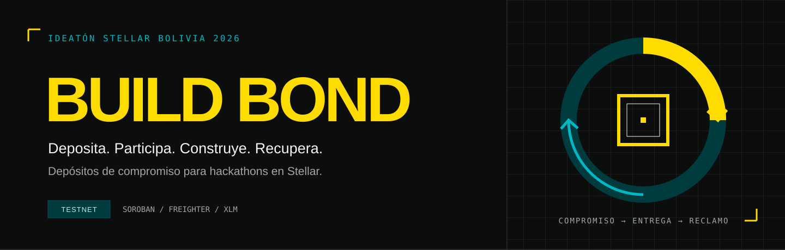
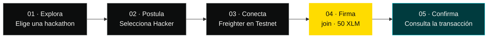
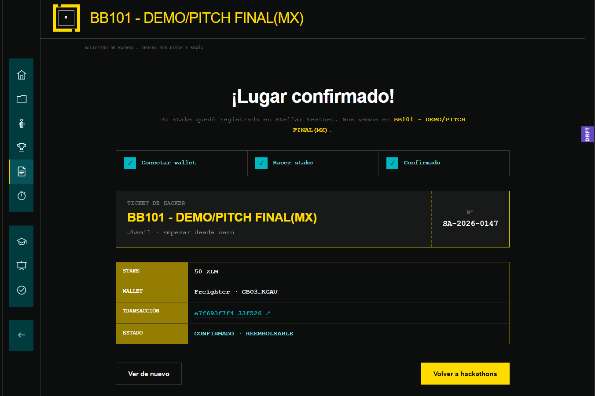
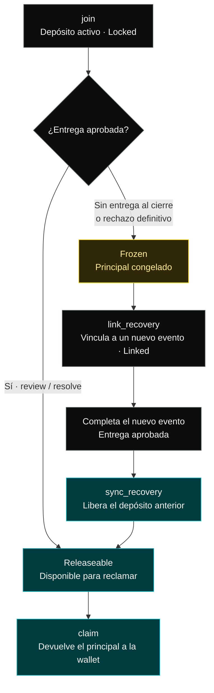
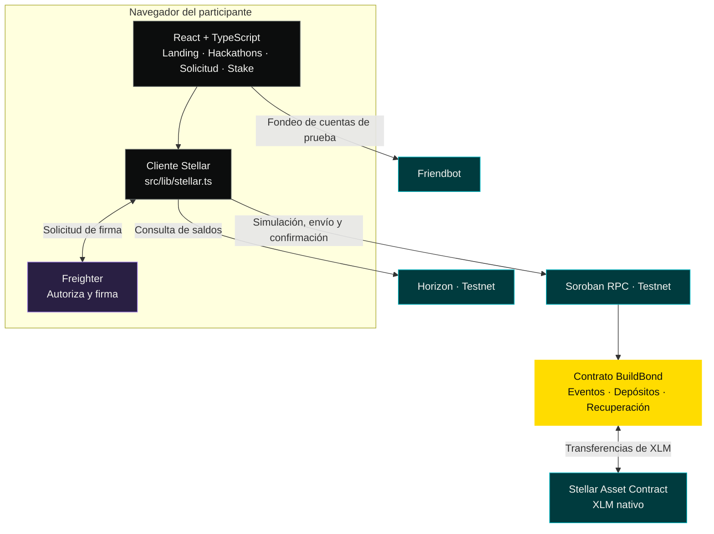

<p align="center">
  
</p>

<h1 align="center">Build Bond · Stellar Apex</h1>

<p align="center">
  Depósitos de compromiso reembolsables para hackathons.<br />
  <strong>Una primera experiencia financiera en Stellar, con una segunda oportunidad para completar.</strong>
</p>

<p align="center">
  <a href="https://build-bond.vercel.app/"><strong>Explorar la demo</strong></a> ·
  <a href="#evidencia">Prueba de staking</a> ·
  <a href="#arquitectura">Arquitectura</a> ·
  <a href="#desarrollo">Ejecutar localmente</a>
</p>

| Red de la demo | Depósito configurado | Firma | Contrato |
| :---: | :---: | :---: | :---: |
| **Stellar Testnet** | **50 XLM** | **Freighter** | **Soroban · Rust** |

> **Estado del proyecto:** prototipo con staking integrado en Testnet. La lista de hackathons y la aceptación de solicitudes son de demostración. Los activos de prueba no tienen valor real.

**Contenido** · [Propuesta](#propuesta) · [Recorrido](#recorrido) · [Evidencia](#evidencia) · [Recuperación](#recuperacion) · [Arquitectura](#arquitectura) · [Contratos](#contratos) · [Desarrollo](#desarrollo) · [Equipo](#equipo)

---

<a id="propuesta"></a>

## 01 / Un compromiso con segunda oportunidad

En una hackathon, registrarse y llegar a entregar son compromisos distintos. Build Bond propone confirmarlos con un depósito que queda registrado a nombre del participante en un contrato Soroban.

El hacker conecta su wallet, reserva un monto para el evento y recupera su principal cuando la entrega es aprobada. Si no completa el evento, el depósito puede quedar congelado; completar otro evento compatible permite recuperar los depósitos anteriores que haya vinculado.

| Para el participante | Para el organizador |
| --- | --- |
| Practicar con una wallet, la red y un saldo comprometido. | Contar con una confirmación de participación respaldada por un depósito. |
| Consultar su transacción y el estado de su bond. | Aplicar reglas de admisión, revisión y devolución definidas por evento. |
| Recuperar un depósito congelado mediante una entrega posterior válida. | Separar la evaluación humana de la ejecución monetaria del contrato. |

**El “staking” de la interfaz es un depósito de participación:** no genera intereses ni representa validación de la red.

<a id="recorrido"></a>

## 02 / De la inscripción a la confirmación



1. Entra a [la demo](https://build-bond.vercel.app/) y pulsa **Probar demo**.
2. Abre una hackathon, selecciona **Hacker**, revisa la solicitud y continúa al stake.
3. Conecta **Freighter en Testnet**. Si la cuenta no está fondeada, la interfaz ofrece Friendbot.
4. Mantén al menos **51.5 XLM**, el umbral que exige la interfaz para cubrir el depósito de 50 XLM y un margen de reserva/comisiones.
5. Firma y espera la confirmación. El comprobante enlaza la transacción en Stellar Expert.

Si la wallet ya tiene un bond en el evento de demo, la aplicación muestra su estado sin pedir otro depósito. También puedes recorrer el **modo demo sin Freighter**: simula la confirmación y no envía una transacción.

<a id="evidencia"></a>

## 03 / Staking probado en Testnet

La siguiente captura, compartida por Omar, muestra el flujo completado desde la aplicación: wallet conectada, depósito de **50 XLM** y confirmación de participación.

[](https://stellar.expert/explorer/testnet/tx/e7f693f7f4205dedb9f892d3ea6948a02b2625115ddf91383e9dd8b69f33f526)

| Dato de la prueba | Evidencia |
| --- | --- |
| Evento mostrado | **BB101 - DEMO/PITCH FINAL(MX)** |
| Depósito | **50 XLM** |
| Wallet | **Freighter** |
| Estado mostrado | **CONFIRMADO · REEMBOLSABLE** |
| Registro público | [Abrir transacción en Stellar Expert ↗](https://stellar.expert/explorer/testnet/tx/e7f693f7f4205dedb9f892d3ea6948a02b2625115ddf91383e9dd8b69f33f526) |

<details>
<summary>Ver hash completo de la transacción</summary>

```text
e7f693f7f4205dedb9f892d3ea6948a02b2625115ddf91383e9dd8b69f33f526
```

</details>

La captura acredita el flujo de depósito reportado por el equipo; **no muestra una devolución ya ejecutada**. El registro de pruebas del contrato documenta por separado devolución, congelamiento y recuperación: [ver despliegues y pruebas](Contracts/build-bond/DEPLOYMENTS.md).

<a id="recuperacion"></a>

## 04 / Cómo se recupera un depósito

El siguiente diagrama resume las rutas principales del contrato. La interfaz actual cubre el depósito y la consulta de un bond existente; las operaciones posteriores de entrega, revisión, recuperación y reclamo todavía se ejecutan fuera de ella.



La recuperación exige la **misma persona titular**, otro evento compatible, un nuevo bond activo y vincular los depósitos elegibles antes del inicio del nuevo evento. Recuperar significa devolver principal; no añadir rendimiento. El contrato también contempla cancelaciones, apelaciones y salidas de seguridad, omitidas en este esquema para facilitar la lectura.

**Prueba documentada del ciclo:** en v1, un participante recuperó **2 XLM** mediante un reclamo que agrupó su depósito actual y otro previamente congelado. Los IDs de evento y las referencias de transacción están en [DEPLOYMENTS.md](Contracts/build-bond/DEPLOYMENTS.md).

<a id="arquitectura"></a>

## 05 / Arquitectura del prototipo



La integración actual llama directamente a Stellar desde el navegador y solicita la firma a Freighter. No necesita un backend para autorizar wallets en el evento público de demo: v2 admite el ingreso mediante `open_admission = true`.

| Capa | Implementación |
| --- | --- |
| Interfaz | React 19, TypeScript, Vite 8 y CSS responsive. |
| Wallet | `@stellar/freighter-api`: conexión, red y firma. |
| Red | `@stellar/stellar-sdk`, Horizon, Soroban RPC y Friendbot de Testnet. |
| Contrato | Rust, Soroban SDK y módulos de admisión, depósito, revisión, recuperación y reclamo. |
| Imágenes | Siete banners WebP; títulos seleccionables en HTML. |

### Qué puedes probar hoy

| Capacidad | Estado |
| --- | --- |
| Landing, catálogo de eventos y formulario de solicitud | **Disponible** · datos y aceptación de demo. |
| Firma de un depósito de 50 XLM con Freighter | **Integrado en Testnet** · evento público de v2. |
| Detección del bond existente y errores legibles del contrato | **Integrado** en el cliente Stellar. |
| Devolución, congelamiento y recuperación de depósitos | **Implementado en el contrato** · pruebas documentadas de v1. |
| Interfaz para entregar, revisar, recuperar y reclamar | **Pendiente**. |
| Una configuración on-chain distinta por cada hackathon | **Pendiente** · todos los eventos visuales usan el mismo evento de demo. |
| Depósitos en USDC desde la interfaz | **Pendiente** · el evento integrado acepta XLM. |

<a id="contratos"></a>

## 06 / Contratos y configuración de Testnet

| Versión | Propósito | Explorador |
| --- | --- | --- |
| **v2 · frontend actual** | Evento `1`, admisión abierta y depósito de **50 XLM**. | [Ver contrato v2 ↗](https://stellar.expert/explorer/testnet/contract/CCLJNTWWDKPVT4LFXH7QLZSLV3FKOTRC5DZX3MVPW3C5Y5PFKUH7AVHQ) |
| **v1 · despliegue inicial** | Contrato compartido por el equipo; pruebas del ciclo completo. | [Ver contrato v1 ↗](https://stellar.expert/explorer/testnet/contract/CA7RKAA7GG6UFVM2XNXNQ26Y7RPQMVHNQNH3QKI53QP5CILJ4M75HQ4P) |

<details>
<summary>Direcciones completas y servicios utilizados</summary>

**BuildBond v2 — configuración predeterminada del frontend**

```text
CCLJNTWWDKPVT4LFXH7QLZSLV3FKOTRC5DZX3MVPW3C5Y5PFKUH7AVHQ
```

**BuildBond v1 — despliegue inicial**

```text
CA7RKAA7GG6UFVM2XNXNQ26Y7RPQMVHNQNH3QKI53QP5CILJ4M75HQ4P
```

| Servicio | Endpoint |
| --- | --- |
| Horizon | `https://horizon-testnet.stellar.org` |
| Soroban RPC | `https://soroban-testnet.stellar.org` |
| Friendbot | `https://friendbot.stellar.org` |
| Red | `Test SDF Network ; September 2015` |

</details>

El [registro de despliegues](Contracts/build-bond/DEPLOYMENTS.md) detalla las versiones y sus pruebas. El contrato v1 se conserva como evidencia histórica; el cliente utiliza v2 por defecto.

<a id="desarrollo"></a>

## 07 / Ejecutar y contribuir

### Inicio rápido

Requisitos: **Node.js 20.19+ o 22.12+**, compatible con Vite 8, y **pnpm**.

```bash
git clone https://github.com/OmarQV/build-bond.git
cd build-bond
pnpm install --frozen-lockfile
pnpm dev
```

Abre la URL que indica Vite. Freighter solo es necesaria para probar el depósito real en Testnet.

| Comando | Resultado |
| --- | --- |
| `pnpm dev` | Servidor de desarrollo con recarga automática. |
| `pnpm build` | Validación TypeScript y compilación de producción en `dist/`. |
| `pnpm lint` | Revisión del código con Oxlint. |
| `pnpm preview` | Vista previa de la compilación de producción. |

### Variables de entorno

La demo incluye valores predeterminados en [`src/lib/stellar.ts`](src/lib/stellar.ts). Para usar otra instancia, copia [`.env.example`](.env.example) a `.env.local` y configura:

| Variable | Debe coincidir con |
| --- | --- |
| `VITE_BUILD_BOND_CONTRACT_ID` | La dirección del contrato desplegado. |
| `VITE_BUILD_BOND_EVENT_ID` | El evento que recibirá el depósito. |
| `VITE_BUILD_BOND_RULES_HASH` | El hash de reglas registrado para ese evento. |

Reinicia Vite después de modificar las variables. Si cambias el monto del evento, ajusta también `BUILD_BOND_AMOUNT_XLM`. La firma permanece en Freighter: **no agregues claves privadas al frontend**.

### Mapa del repositorio

```text
build-bond/
├── src/
│   ├── Landing.tsx              Presentación del producto
│   ├── App.tsx                  Hackathons y selección de rol
│   ├── HackerApplication.tsx    Solicitud de participación
│   ├── StakeStep.tsx            Wallet, depósito y comprobante
│   └── lib/stellar.ts           Cliente y configuración Stellar
├── public/images/hackathons/    Banners de los siete eventos
├── Contracts/build-bond/        Workspace Rust / Soroban
│   └── contracts/build-bond/src/
│       ├── lib.rs               Interfaz pública del contrato
│       ├── deposits.rs          Ingreso y cancelación
│       ├── decisions.rs         Revisión y normalización
│       ├── recovery.rs          Vinculación y recuperación
│       └── claims.rs            Reclamo del principal
└── docs/
    ├── media/                   Portada y evidencia de staking
    └── previews/                Capturas de revisión visual
```

<details>
<summary>Documentación de diseño y producción</summary>

- [Despliegues y pruebas del contrato](Contracts/build-bond/DEPLOYMENTS.md).
- [Especificación de contratos](docs/contrato.md) · documento de diseño; el código y los despliegues determinan el comportamiento implementado.
- [Arquitectura objetivo del monorepo](docs/ARQUITECTURA-MONOREPO.md) · propuesta de estructura futura.
- [Documento maestro de Build Bond](MAESTRO-BUILD-BOND-APEX.md).
- [Prompts y producción de banners](docs/HACKATHON-BANNERS.md).

</details>

<a id="equipo"></a>

## 08 / Equipo

**Omar Quispe** · **Alejandro Cosulich** · **Jhamil Mamani** · **Saul Choquehuanca**

---

<p align="center">
  <strong>Deposita. Participa. Construye. Recupera.</strong><br />
  Propuesta para la Ideatón Stellar Bolivia 2026.<br />
  <sub>Prototipo independiente; no es un producto oficial de APEX ni de la Stellar Development Foundation.</sub>
</p>
