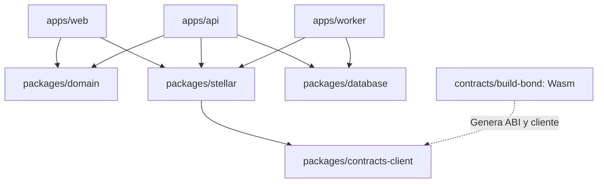

# Build Bond — Arquitectura final del monorepo

Versión 1.0 · 18 de octubre de 2026 · **Estructura objetivo; no reorganización ya ejecutada.**

Especificación monetaria y ABI propuesta: [Contracts/contrato.md](../Contracts/contrato.md). Después de normalizar el nombre de la carpeta, la ruta canónica será `contracts/contrato.md`.

### Índice

- [1. Decisión de arquitectura](#1-decisión-de-arquitectura)
- [2. Estado observado y diferencia con el objetivo](#2-estado-observado-y-diferencia-con-el-objetivo)
- [3. Árbol final propuesto](#3-árbol-final-propuesto)
- [4. Responsabilidades y límites de importación](#4-responsabilidades-y-límites-de-importación)
- [5. Organización interna del contrato](#5-organización-interna-del-contrato)
- [6. Workspaces y comandos objetivo](#6-workspaces-y-comandos-objetivo)
- [7. Manifiestos de despliegue y cliente generado](#7-manifiestos-de-despliegue-y-cliente-generado)
- [8. Configuración y secretos](#8-configuración-y-secretos)
- [9. Backend, datos y consistencia](#9-backend-datos-y-consistencia)
- [10. Migración desde la estructura actual](#10-migración-desde-la-estructura-actual)
- [11. CI y condiciones de entrega](#11-ci-y-condiciones-de-entrega)
- [12. Alcance y siguientes hitos](#12-alcance-y-siguientes-hitos)

## 1. Decisión de arquitectura

Un repositorio con dos workspaces coordinados:

- **pnpm workspace:** aplicación web, API, worker y paquetes TypeScript compartidos.
- **Cargo workspace:** contrato Rust/Soroban `build-bond` y sus pruebas.

Mantener React/TypeScript/Vite del frontend actual. El monorepo no exige reescribirlo en Next.js. Propuesta para la capa nueva: API TypeScript con Fastify, PostgreSQL y migraciones Drizzle; worker Node para indexar Stellar y ejecutar mantenimiento. Son elecciones nuevas, no dependencias encontradas en el repositorio.

El usuario confirma Vercel como publicación de la app; la app web puede seguir allí. API y worker requieren un entorno de ejecución y presupuesto propios. El worker es un proceso operativo: no basta con desplegar una SPA ni asumir que Vercel mantendrá un bucle Node permanente.

El contrato es una instancia multi-evento por red/versión. Se mantienen admisión, depósito, revisión y recuperación en el mismo contrato, con módulos internos separados. No crear microservicios ni varios contratos solo para reflejar cada carpeta del dominio.

## 2. Estado observado y diferencia con el objetivo

Referencia remota: [`aeac569867dabfe4d6b24c643d5ba8aa26bb7a62`](https://github.com/OmarQV/build-bond/tree/aeac569867dabfe4d6b24c643d5ba8aa26bb7a62). La copia local inspeccionada estaba en `efa484a173d8c5057e248581920df8496862e1f7`, por lo que no se presume que contenga todos los cambios remotos.

| Hoy, según inspección | Objetivo |
|---|---|
| `src/`, `public/`, `index.html`, Vite y TS en raíz | Mover frontend a `apps/web/` |
| `package.json` llamado `vite-project` | Raíz privada de workspace y app `@build-bond/web` |
| Un lockfile pnpm | Conservar un lockfile en raíz con todos los importers |
| `Contracts/contrato.md` vacío en snapshot remoto | Especificación redactada aquí; normalizar luego a `contracts/contrato.md` |
| Sin Cargo workspace observado | Crear raíz Rust y crate `contracts/build-bond/` |
| Sin SDK Stellar en manifiesto inspeccionado | Cliente Stellar y bindings generados con versiones fijadas |
| Datos de eventos dentro de `App.tsx` | Catálogo por API; fixtures demo aislados |
| UI publicada de catálogo | Inscripción, wallet, bond, entrega, revisión y recuperación completas |

Consultar una web o un árbol Git no demuestra que haya un backend o contrato oculto funcionando. La especificación distingue claramente archivos existentes de los que deben crearse. Esta tarea solo añade documentación local.

## 3. Árbol final propuesto

Todos los nombres bajo `contracts/` en este árbol son en minúsculas. Las carpetas anotadas como generadas, opcionales o futuras no se confunden con implementación ya presente.

```text
build-bond/
├── .github/
│   └── workflows/
│       ├── web.yml                         # typecheck, lint y build
│       ├── backend.yml                     # API/worker y migraciones de prueba
│       ├── contracts.yml                   # fmt, clippy, tests y build Wasm
│       ├── bindings.yml                    # verifica ABI y cliente generado
│       └── testnet-release.yml             # ejecución manual y entorno protegido
├── .gitignore
├── .env.example                            # nombres y valores públicos de ejemplo
├── .oxlintrc.json
├── .npmrc
├── package.json                            # scripts de coordinación; private
├── pnpm-workspace.yaml
├── pnpm-lock.yaml
├── tsconfig.base.json
├── Cargo.toml                              # workspace Rust
├── Cargo.lock
├── rust-toolchain.toml                     # toolchain fijado tras validación
├── README.md
├── SECURITY.md
├── apps/
│   ├── web/
│   │   ├── package.json                    # @build-bond/web
│   │   ├── index.html
│   │   ├── vite.config.ts
│   │   ├── tsconfig.json
│   │   ├── tsconfig.app.json
│   │   ├── tsconfig.node.json
│   │   ├── .env.example
│   │   ├── public/
│   │   │   ├── favicon.svg
│   │   │   └── icons.svg
│   │   └── src/
│   │       ├── main.tsx
│   │       ├── app/
│   │       │   ├── App.tsx
│   │       │   ├── router.tsx
│   │       │   ├── providers.tsx
│   │       │   └── layouts/ApexLayout.tsx
│   │       ├── components/                 # controles compartidos de esta app
│   │       ├── features/
│   │       │   ├── hackathons/              # catálogo y detalle
│   │       │   ├── applications/            # solicitud y estado
│   │       │   ├── learning/                # recorrido XLM/USDC
│   │       │   ├── wallet/                  # conexión y firma
│   │       │   ├── build-bond/              # depósito, saldos y reclamo
│   │       │   ├── recovery/                # eventos compatibles y vínculos
│   │       │   ├── teams/                   # miembros y contribución
│   │       │   ├── submissions/             # snapshot y recibo
│   │       │   └── organizer/               # revisión y apelaciones
│   │       ├── lib/
│   │       │   ├── api-client.ts
│   │       │   └── network-config.ts
│   │       ├── styles/
│   │       │   ├── tokens.css
│   │       │   └── global.css
│   │       ├── assets/
│   │       └── test/
│   ├── api/
│   │   ├── package.json                    # @build-bond/api
│   │   ├── tsconfig.json
│   │   ├── .env.example
│   │   └── src/
│   │       ├── server.ts
│   │       ├── app.ts
│   │       ├── plugins/                    # sesión, DB, acceso y errores
│   │       └── modules/
│   │           ├── auth/
│   │           ├── hackathons/
│   │           ├── applications/
│   │           ├── teams/
│   │           ├── submissions/
│   │           ├── reviews/
│   │           ├── appeals/
│   │           └── bond-intents/           # prepara operaciones; no firma por usuario
│   └── worker/
│       ├── package.json                    # @build-bond/worker
│       ├── tsconfig.json
│       ├── .env.example
│       └── src/
│           ├── main.ts
│           ├── jobs/
│           │   ├── index-contract-events.ts
│           │   ├── reconcile-liabilities.ts
│           │   ├── finalize-participations.ts
│           │   ├── sync-recovery-links.ts
│           │   └── maintain-storage-ttl.ts
│           ├── scheduler.ts
│           └── health.ts
├── packages/
│   ├── domain/                             # @build-bond/domain
│   │   ├── package.json
│   │   └── src/
│   │       ├── ids.ts
│   │       ├── application.ts
│   │       ├── submission-manifest.ts
│   │       └── api-schemas.ts
│   ├── contracts-client/                   # @build-bond/contracts-client
│   │   ├── package.json
│   │   ├── tsconfig.json
│   │   ├── README.md
│   │   └── src/generated/                  # generado desde Wasm/ABI; no editar a mano
│   ├── stellar/                            # @build-bond/stellar
│   │   ├── package.json
│   │   └── src/
│   │       ├── client.ts
│   │       ├── networks.ts
│   │       ├── amounts.ts
│   │       ├── transaction-status.ts
│   │       └── errors.ts
│   ├── database/                           # @build-bond/database; solo servidor
│   │   ├── package.json
│   │   ├── drizzle.config.ts
│   │   ├── migrations/
│   │   └── src/
│   │       ├── client.ts
│   │       └── schema/
│   │           ├── users.ts
│   │           ├── hackathons.ts
│   │           ├── applications.ts
│   │           ├── teams.ts
│   │           ├── submissions.ts
│   │           ├── reviews.ts
│   │           ├── appeals.ts
│   │           ├── chain-events.ts
│   │           └── chain-projections.ts
│   └── config/                             # @build-bond/config
│       ├── package.json
│       └── src/
│           ├── public.ts
│           └── server.ts                   # validación de env privada; no importar en web
├── contracts/
│   ├── contrato.md                         # esta especificación tras normalizar carpeta
│   └── build-bond/
│       ├── Cargo.toml                      # crate build-bond; cdylib
│       └── src/
│           ├── lib.rs                      # entradas públicas, constructor y exports
│           ├── types.rs
│           ├── errors.rs
│           ├── events.rs
│           ├── storage.rs
│           ├── admin.rs
│           ├── event_registry.rs
│           ├── admissions.rs
│           ├── deposits.rs
│           ├── submissions.rs
│           ├── decisions.rs
│           ├── appeals.rs
│           ├── recovery.rs
│           ├── claims.rs
│           ├── safety_exit.rs
│           └── tests/
│               ├── mod.rs
│               ├── fixtures.rs
│               ├── authorization.rs
│               ├── deposits.rs
│               ├── decisions.rs
│               ├── appeals.rs
│               ├── recovery.rs
│               ├── claims.rs
│               ├── deadlines.rs
│               ├── ttl.rs
│               └── invariants.rs
├── deployments/
│   ├── README.md
│   ├── testnet/build-bond.json              # solo tras despliegue comprobado
│   └── mainnet/.gitkeep                     # sin direcciones ficticias
├── scripts/
│   ├── contracts-build.mjs
│   ├── contracts-bindings.mjs
│   ├── validate-deployment.mjs
│   ├── deploy-testnet.mjs
│   └── seed-demo.mjs                        # rechaza mainnet explícitamente
├── tests/
│   ├── e2e/
│   │   ├── application.spec.ts
│   │   ├── build-bond.spec.ts
│   │   └── recovery.spec.ts
│   ├── integration/
│   │   ├── api-chain.test.ts
│   │   ├── indexer-replay.test.ts
│   │   └── deployment-manifest.test.ts
│   └── fixtures/                           # datos demo; nunca la evidencia real privada
├── infra/
│   ├── compose.yaml                        # PostgreSQL y servicios locales de apoyo
│   └── README.md                           # entornos API/worker, backups y recuperación
└── docs/
    ├── ARQUITECTURA-MONOREPO.md
    ├── product/MAESTRO-BUILD-BOND-APEX.md    # trasladar fuente actual, evitar copias divergentes
    ├── api/openapi.yaml
    ├── adr/
    │   ├── 001-single-multi-event-contract.md
    │   ├── 002-no-forfeiture.md
    │   └── 003-timeouts-and-safety-exit.md
    └── runbooks/
        ├── testnet-demo.md
        ├── deployment.md
        ├── incident-response.md
        ├── ttl-and-restoration.md
        └── program-exit.md
```

No versionar `node_modules/`, `target/`, `dist/`, claves privadas, frases semilla ni archivos `.env` reales. El ABI/cliente generado sí puede versionarse si CI verifica su correspondencia con el Wasm de referencia. Los binarios de release y sus hashes deben publicarse como artefactos de una versión controlada, no como builds anónimos dentro de `src/`.

## 4. Responsabilidades y límites de importación

| Workspace | Responsabilidad | No debe contener |
|---|---|---|
| `apps/web` | Navegación, aprendizaje, formularios, conexión wallet y firma | Claves de servidor, acceso directo a DB ni aprobación monetaria local |
| `apps/api` | Cuenta, postulación, equipo, evidencia privada y decisiones autorizadas | Custodia de claves del hacker o principal |
| `apps/worker` | Proyectar cadena, conciliar, finalizar condiciones objetivas y mantener TTL | Decisiones de mérito inventadas por un job |
| `packages/domain` | Validaciones de API y manifiestos off-chain | Reescritura independiente de la máquina de estados monetaria |
| `packages/contracts-client` | Tipos y métodos generados desde ABI | Lógica manual de depósitos o archivos generados modificados a mano |
| `packages/stellar` | Adaptadores, montos, simulación, red y seguimiento de tx | Secretos, PII o un endpoint de retiro arbitrario |
| `packages/database` | Esquema, migraciones y consultas de servidor | Importaciones en el bundle de navegador |
| `packages/config` | Validación de configuración pública/privada separada | Exportar todas las variables del proceso a la web |
| `contracts/build-bond` | Principal, permisos y reglas de recuperación | Emails, CV, entrevistas completas o compra fiat |



La decisión económica canónica vive en Rust. Los tipos del SDK se generan; el frontend los traduce a textos, sin inventar cuándo se puede devolver un bond. La base de datos almacena proyecciones para consultar rápido, no una segunda autoridad sobre quién puede retirar.

Un paquete UI separado se introduce cuando exista reutilización real entre varias aplicaciones. Por ahora los controles visuales viven en `apps/web/src/components`; no se necesita una librería de diseño publicada para una sola app.

## 5. Organización interna del contrato

| Archivo | Responsabilidad concreta |
|---|---|
| `lib.rs` | `#![no_std]`, declaración del contrato y funciones públicas delgadas |
| `types.rs` | Configuración, posiciones, estados y payloads serializables |
| `storage.rs` | Claves, lecturas/escrituras, índices paginados y extensión de TTL |
| `admin.rs` | Gobernanza, tokens/organizadores permitidos y pausa de entradas |
| `event_registry.rs` | Configuración inmutable, fechas, cancelación y cupos |
| `admissions.rs` | Permisos por evento y propietario, consumo y revocación previa al depósito |
| `deposits.rs` | `join`, unicidad y transferencia entrante |
| `submissions.rs` | Anclar snapshot firmado por participante dentro del plazo |
| `decisions.rs` | Revisar y normalizar resultados según estado/reloj |
| `appeals.rs` | Recurso, resolución y timeout sin falsear cumplimiento |
| `recovery.rs` | Vínculo a evento futuro y sincronización sin listas ilimitadas |
| `claims.rs` | Lotes acotados, transferencias exactas y obligaciones por token |
| `safety_exit.rs` | Excepción temporal publicada y devolución sin mérito |
| `events.rs` | Eventos con versión y sin PII |
| `errors.rs` | Códigos estables de dominio |
| `tests/` | Autorización, dinero, recuperación, fronteras temporales y propiedades |

Los módulos internos no tienen balances propios. Solo la dirección de BuildBond custodia el principal. La subdivisión por archivo no crea un puente entre contratos.

## 6. Workspaces y comandos objetivo

Configuración objetivo de pnpm:

```yaml
# pnpm-workspace.yaml
packages:
  - apps/*
  - packages/*
```

Configuración inicial del workspace Rust:

```toml
# Cargo.toml de raíz; esquema parcial
[workspace]
members = ["contracts/build-bond"]
resolver = "2"
```

Fijar una versión exacta de `soroban-sdk` compatible con Stellar CLI, Rust y la red objetivo, incluirla como dependencia de workspace y registrar la matriz probada en README. No se coloca aquí un número de SDK tomado de un chat sin verificarlo. El target oficial observado en la documentación es `wasm32v1-none`; comprobar el toolchain instalado al iniciar el desarrollo.

| Comando objetivo desde raíz | Responsabilidad |
|---|---|
| `pnpm dev:web` | Alias de `pnpm --filter @build-bond/web dev` |
| `pnpm dev:api` | Alias de `pnpm --filter @build-bond/api dev` |
| `pnpm dev:worker` | Alias de `pnpm --filter @build-bond/worker dev` |
| `pnpm build:web` | Build del cliente generado y dependencias TypeScript, después web |
| `pnpm typecheck` / `pnpm lint` | Comprobaciones del workspace JS/TS |
| `pnpm test` | Tests JS/TS; no se presenta como ejecución de tests Rust |
| `pnpm contracts:test` | Alias de `cargo test --workspace --locked` |
| `pnpm contracts:build` | Wrapper del flujo Stellar CLI que produce el Wasm verificado |
| `pnpm contracts:bindings` | Generación de bindings desde el Wasm; falla si falta build |
| `pnpm test:e2e` | Flujos web con servicios de prueba y red declarada |
| `pnpm validate:deployment` | Comprueba manifiesto, red, contrato, ABI y activo |

Los alias son por implementar, no comandos ya disponibles. El wrapper de generación de bindings debe emplear la sintaxis del CLI fijado; el tutorial consultado usa `stellar contract build` para compilar. No se asegura que comandos dependientes de versiones no instaladas funcionen todavía.

Mantener **un `pnpm-lock.yaml`** y **un `Cargo.lock`** en raíz. El uso de pnpm no administra dependencias Rust y Cargo no compila React. Un orquestador adicional como Turborepo no es necesario para el tamaño inicial; se incorpora solo si el costo de builds y caché lo justifica.

## 7. Manifiestos de despliegue y cliente generado

`deployments/<network>/build-bond.json` se crea tras un despliegue real y verificado. Debe contener:

```text
schema_version
network_name
network_passphrase
rpc_url
contract_id
wasm_sha256
source_commit
sdk_version
stellar_cli_version
deployed_at
deployment_tx_hash
abi_hash
allowed_assets[]: { code, issuer, sac_address, decimals }
```

No llenar `contract_id`, hashes o transacciones con ejemplos que parezcan reales. La configuración pública de la app se deriva de un manifiesto validado por red. Los clientes locales y CI comprueban que el contrato desplegado corresponde al Wasm/ABI esperado antes de presentar una transacción.

Los bindings se generan desde un artefacto identificado por hash; no desde un contrato mutable seleccionado sin versión. Cambiar ABI requiere actualizar bindings, adaptador, pruebas y manifiesto de forma coherente. El código generado no se corrige manualmente para que «pase» TypeScript.

## 8. Configuración y secretos

| Destino | Configuración pública o privada |
|---|---|
| Web | `VITE_API_BASE_URL`, `VITE_STELLAR_NETWORK`, `VITE_STELLAR_RPC_URL`, `VITE_BUILD_BOND_CONTRACT_ID`; toda variable `VITE_*` debe considerarse pública |
| API | `DATABASE_URL`, origen de sesión, credenciales de storage privado y referencia al firmante de admisión/revisión |
| Worker | Red/contrato, conexión DB, cursor, presupuesto y referencia al firmante de fees/mantenimiento |
| Gobernanza/árbitro | Política de firma externa; no una variable pública ni una llave distribuida con la aplicación |

El relayer puede pagar operaciones autorizadas sin poseer claves del usuario. Separar claves de admisión, revisión, arbitraje y operación según la política del piloto. No incluir semillas en documentación, fixtures, repositorio o logs.

La ruta de compra fiat se implementa como integración de aplicación con un proveedor disponible; no como función del contrato ni como job del worker. No se promete disponibilidad local de una rampa hasta verificar cobertura y costos.

## 9. Backend, datos y consistencia

La API administra personas y flujo del evento. El contrato administra principal y resultados autorizados. El worker materializa proyecciones:

1. Lee eventos confirmados por red/contrato y guarda el cursor.
2. Inserta eventos con identidad única y procesamiento idempotente.
3. Actualiza proyecciones por bond y activo.
4. Reconcilia obligaciones con lecturas del contrato y balance SAC.
5. Alerta sobre diferencias; no altera saldos de contrato para «hacer coincidir» la base.

La tabla `chain-events` conserva los hechos recibidos; las proyecciones se pueden reconstruir. No se usa una columna `paid=true` de la API como evidencia de transferencia. Un fallo del indexador no autoriza repetir el depósito.

Los manifiestos de entrega usan serialización canónica definida en `packages/domain`; guardar la versión y el hash que el usuario ancla. Una edición posterior crea otra versión hasta el cierre, no reemplaza silenciosamente la evidencia ya presentada.

## 10. Migración desde la estructura actual

Esta es una secuencia de trabajo futura; no se ejecutó al redactar el documento.

1. **Conciliar primero el estado Git.** La copia local y el remoto tienen snapshots distintos. Incorporar cambios sin descartar documentación o trabajo no guardado; no usar reset forzado.
2. **Guardar la documentación nueva.** Este archivo y `Contracts/contrato.md` son los nuevos documentos. El maestro actual vive fuera de la raíz Git local y debe trasladarse deliberadamente a `docs/product/` si se quiere versionar; evitar mantener dos copias canónicas divergentes.
3. **Normalizar `Contracts` a `contracts`.** En Windows/Git usar un nombre temporal intermedio para que un cambio solo de mayúsculas quede registrado; actualizar el enlace desde este documento y el README.
4. **Crear `apps/web`.** Mover allí `src`, `public`, `index.html`, `vite.config.ts` y tsconfigs de aplicación; preservar assets y comportamiento mientras se verifica el build.
5. **Crear workspace raíz.** Convertir `package.json` raíz en coordinador privado; crear manifiesto `@build-bond/web`, `pnpm-workspace.yaml` y configuración compartida. Regenerar el lockfile una vez con la versión fijada de pnpm.
6. **Ajustar Vercel con una migración revisable.** Build desde raíz con `pnpm build:web` y salida `apps/web/dist`, manteniendo la URL pública. Configurar también resolución de rutas SPA según el router. No cambiar dominio ni publicar como parte de una edición documental.
7. **Añadir Cargo workspace y contrato.** Implementar tipos, storage, autorización y transferencia antes de conectar pantallas a dinero real.
8. **Generar bindings y paquete Stellar.** Sustituir mocks de transferencias por invocaciones testnet verificadas.
9. **Añadir API, DB y worker.** Sacar eventos demo del componente, incorporar sesiones y proyecciones sin inventar una integración oficial APEX.
10. **Completar los flujos.** Inscripción, entrega, validación, congelamiento y recuperación de dos eventos con pruebas.

Mover el frontend y cambiar la lógica monetaria en pasos verificables permite identificar fallos de rutas, configuración y comportamiento. No crear un segundo proyecto frontend dentro del mismo repo dejando dos apps indistinguibles en la raíz.

## 11. CI y condiciones de entrega

| Pipeline | Comprobación útil |
|---|---|
| Web | Instalación con lockfile, tipos, lint, build y pruebas de flujos relevantes |
| Backend | API y worker con DB efímera, migraciones, permisos y reejecución del indexador |
| Contratos | `cargo fmt --check`, clippy, tests, build Wasm y reporte del hash generado |
| ABI | Cliente regenerado sin diferencias no explicadas y adaptación TypeScript válida |
| Testnet manual | Deploy con entorno protegido, manifiesto real, smoke test y evidencia de transacciones |

No ejecutar un despliegue mainnet ni usar claves de fondos reales desde un workflow de pull requests. La fase inicial de CI puede limitarse al único workspace existente y crecer cuando se agregan componentes; no añadir jobs que fallen porque se inventaron carpetas vacías.

No hace falta testear archivos de documentación como si fueran lógica de contrato. Antes de entregar este diseño se comprueban rutas, enlaces, consistencia de estados y árbol; los tests monetarios listados pertenecen a la implementación posterior.

## 12. Alcance y siguientes hitos

Los dos documentos creados cubren la lógica y la estructura solicitadas. No se construyeron contratos, no se reorganizó la app, no se ejecutaron builds del sistema futuro y no se publicó una nueva versión.

El primer hito de desarrollo debe ser **dos wallets depositan y recuperan XLM de testnet con autorizaciones correctas**. El siguiente es **A falla, B recibe un nuevo depósito y se completa, y el mismo usuario recupera A+B**. Un timelock que devuelve dinero por esperar sirve como prueba parcial, pero no sustituye ese segundo hito.

Referencias: [repositorio de Build Bond](https://github.com/OmarQV/build-bond), [app observada](https://build-bond.vercel.app/), [conversación revisada](https://chatgpt.com/share/6ad4d942-0534-83e9-bf27-cf2e42cb5291), [guía oficial de desarrollo Soroban](https://developers.stellar.org/docs/build/smart-contracts/getting-started/storing-data).
