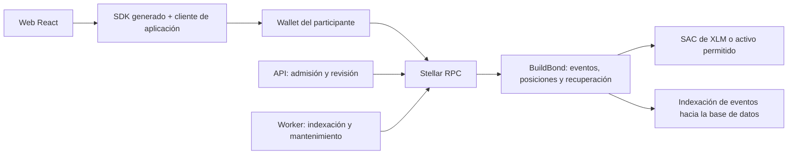
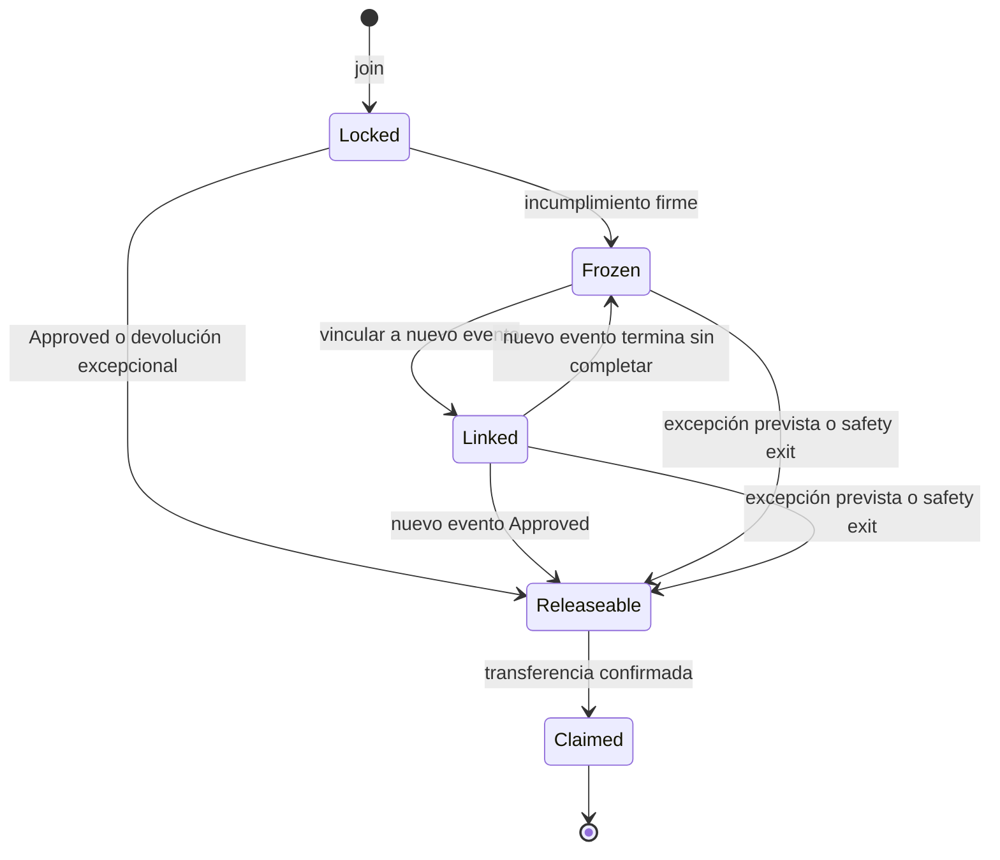

# Build Bond — Especificación de contratos inteligentes

Versión 1.0 · 18 de octubre de 2026 · **Diseño para implementar, no contrato desplegado ni auditado.**

Repositorio: [OmarQV/build-bond](https://github.com/OmarQV/build-bond). Aplicación observada: [build-bond.vercel.app](https://build-bond.vercel.app/). Estructura final propuesta: [ARQUITECTURA-MONOREPO.md](../docs/ARQUITECTURA-MONOREPO.md).

Esta especificación concreta la sección de contratos del documento maestro. Conserva la regla del equipo: no entregar congela el depósito; completar otro evento con un nuevo depósito permite recuperar el actual y los anteriores vinculados. Define propuestas técnicas nuevas donde el maestro dejaba decisiones abiertas; deben revisarse como reglas antes de usar fondos reales.

### Índice

- [1. Qué aporta la conversación compartida](#1-qué-aporta-la-conversación-compartida)
- [2. Decisión: un contrato productivo, varios módulos](#2-decisión-un-contrato-productivo-varios-módulos)
- [3. Reglas de producto que el contrato debe preservar](#3-reglas-de-producto-que-el-contrato-debe-preservar)
- [4. Roles y autorización](#4-roles-y-autorización)
- [5. Modelo de dominio y estados separados](#5-modelo-de-dominio-y-estados-separados)
- [6. Tiempo, plazos y protección ante inactividad](#6-tiempo-plazos-y-protección-ante-inactividad)
- [7. Interfaz pública propuesta](#7-interfaz-pública-propuesta)
- [8. Algoritmos críticos](#8-algoritmos-críticos)
- [9. Invariantes de seguridad y contabilidad](#9-invariantes-de-seguridad-y-contabilidad)
- [10. Almacenamiento, índices y TTL](#10-almacenamiento-índices-y-ttl)
- [11. Eventos, errores y consistencia con la aplicación](#11-eventos-errores-y-consistencia-con-la-aplicación)
- [12. Pausa, versiones y migración de fondos](#12-pausa-versiones-y-migración-de-fondos)
- [13. Pruebas obligatorias antes de declarar el contrato funcional](#13-pruebas-obligatorias-antes-de-declarar-el-contrato-funcional)
- [14. Secuencia de implementación](#14-secuencia-de-implementación)
- [15. Relación con el maestro y decisiones a ratificar](#15-relación-con-el-maestro-y-decisiones-a-ratificar)
- [16. Fuentes y alcance de verificación](#16-fuentes-y-alcance-de-verificación)

## 1. Qué aporta la conversación compartida

Se leyó la conversación titulada **«Concepto Build Bond»**, accesible desde el navegador en el [enlace compartido](https://chatgpt.com/share/6ad4d942-0534-83e9-bf27-cf2e42cb5291). Contiene el concepto, una explicación técnica y una propuesta de prueba simplificada. No se descargó ni compiló el ZIP mencionado allí; que una respuesta diga «implementado» no prueba que ese código exista en este monorepo.

| Hallazgo del chat | Decisión en esta especificación |
|---|---|
| Rust, Soroban, USDC mediante SAC y verificador externo | Se conserva. |
| `join`, `cancel`, `verify`, `dispute`, `resolve`, `claim`, `pause`, `status` | Se convierten en interfaz con precondiciones y efectos definidos. |
| Un contrato por evento | Se sustituye por un contrato central que gestiona varios eventos, para soportar recuperación cruzada sin mover principal entre bóvedas. |
| `forfeit` envía incumplimientos al fondo comunitario | **Se elimina.** Contradice la regla posterior del equipo de mantener principal recuperable. |
| Reembolso si verificador o árbitro no responde | Se conserva como protección operativa limitada: devuelve el bond actual, sin certificar que completó el evento ni liberar anteriores. |
| `claim` ejecutable por cualquiera | En v1 requiere autorización del propietario. Un relayer puede enviar/pagar la transacción sin cambiar su destino. |
| `deposit/get_deposit/withdraw` por tiempo | Útil como prueba de transferencias; no representa la lógica final de participación. Se implementa como fixture de test si hace falta, no como contrato productivo alternativo. |
| Prueba con dos usuarios y 1 XLM de testnet | Se incorpora como primera prueba técnica. |
| SDK 28 y ZIP inicial sin compilar | Referencia no verificada. Fijar versiones compatibles y lockfiles al iniciar la implementación; no copiar esa versión como garantía. |
| Builder Pass, reputación y yield | Fuera del contrato v1; los derechos de recuperación sí son parte de v1. |

### 1.1 Evidencia actual del repositorio y la app

Se consultó GitHub mediante su conector. Snapshot remoto de referencia: commit [`aeac569867dabfe4d6b24c643d5ba8aa26bb7a62`](https://github.com/OmarQV/build-bond/commit/aeac569867dabfe4d6b24c643d5ba8aa26bb7a62). En ese snapshot, `Contracts/contrato.md` estaba vacío; `package.json` describe una aplicación React/TypeScript/Vite, sin SDK Stellar ni workspace pnpm configurado. La copia local inspeccionada estaba en `efa484a173d8c5057e248581920df8496862e1f7`.

La app publicada pudo leerse desde el navegador: muestra una tabla de siete hackathons y navegación APEX. Ese resultado demuestra una superficie visual publicada, no un flujo financiero implementado. El árbol remoto inspeccionado no contenía contratos Rust, ABI generada, backend ni un `pnpm-workspace.yaml`.

La intención del equipo es un monorepo; estos documentos especifican cómo evolucionar la base actual. No se hizo pull, push, commit, despliegue ni reorganización de código al escribirlos.

## 2. Decisión: un contrato productivo, varios módulos

**Contrato v1: `BuildBond`.** Una instancia por red y versión del programa; cada instancia gestiona varios eventos y varias posiciones por participante. La recuperación de A en B ocurre dentro del mismo contrato.

Módulos Rust internos: `admin`, `event_registry`, `admissions`, `deposits`, `submissions`, `decisions`, `appeals`, `recovery`, `claims`, `safety_exit`, `storage`, `types`, `events` y `errors`. Separar archivos no crea contratos ni autoridades adicionales.



Se evita introducir inicialmente Factory, contrato de badges, token propio, smart wallet propia, bóveda de ahorro y protocolos de yield. Un Factory tendría sentido si se requiere aislamiento por organizador; incorporarlo obligaría a diseñar antes un protocolo de recuperación entre instancias. La v1 solo reconoce recuperaciones dentro de su propia instancia y red.

**Límite de confianza:** el contrato aplica reglas monetarias. Un revisor autorizado decide si la entrega cumple el checklist. La cadena no comprueba por sí sola asistencia, entrevistas, calidad del video ni originalidad del código.

## 3. Reglas de producto que el contrato debe preservar

| ID | Regla |
|---|---|
| C-01 | El participante deposita después de ser admitido, antes del límite de confirmación. |
| C-02 | Una inscripción tiene un único bond de monto fijo, token fijo y propietario inmutable. |
| C-03 | El contrato conserva el principal; no produce intereses ni recompensas de consenso. |
| C-04 | Entrega válida individual habilita el reclamo del principal completo, sin exigir premio o finalismo. |
| C-05 | Incumplimiento firme produce congelamiento, sin multa ni transferencia comunitaria. |
| C-06 | Recuperar un bond anterior exige un nuevo bond para un evento posterior compatible. El anterior no paga la nueva inscripción. |
| C-07 | Completar B habilita su bond y los anteriores que el usuario vinculó antes del inicio de B. |
| C-08 | Fallar nuevamente no borra derechos: se mantienen anteriores y se congela el nuevo. |
| C-09 | Un bond solo se vincula a una participación futura a la vez y siempre del mismo propietario. |
| C-10 | La cancelación, un timeout operativo o una salida de seguridad devuelven el actual, pero no certifican cumplimiento de B para recuperar A. |
| C-11 | Token, monto, fechas, autoridades y hash de reglas quedan fijados al publicar el evento. |
| C-12 | No existe retiro de principal a tesorería, `forfeit`, inversión de fondos ni conversión automática. |
| C-13 | Las unidades se restituyen en el mismo activo y cantidad; no se garantiza equivalencia fiat. |
| C-14 | Ninguna operación recorre todos los participantes ni una lista sin límite. |
| C-15 | Los datos personales y las evidencias completas permanecen fuera de blockchain. |

### 3.1 Configuración inicial propuesta

En testnet: depósito de 1 XLM para validar transferencias; después dos eventos con 20 unidades de un token de prueba o USDC de testnet verificado. Son escenarios de prueba distintos. Ningún token de prueba se comunica como dinero real.

En un piloto real: monto propuesto de 20 USDC, sujeto a validar accesibilidad; un token admitido por evento. Usar la dirección SAC, red, código y emisor comprobados. Consultar `decimals()` del token permitido, sin asumir los decimales de USDC de otra red. Las comisiones y reservas de cuenta son distintas del principal.

## 4. Roles y autorización

| Rol | Permisos | No puede hacer |
|---|---|---|
| Gobernanza del programa | Autorizar organizadores/tokens, pausar nuevas entradas | Retirar dinero ajeno, reescribir eventos publicados o decidir cualquier entrega |
| Organizador | Publicar su evento, admitir participantes y cancelar el evento | Cambiar propietario, principal o resultado individual sin ser revisor |
| Revisor del evento | Aprobar/rechazar entregas registradas | Reclamar dinero o usar nuevas reglas |
| Árbitro del evento | Resolver apelación y emergencias previstas | Resolver su propia decisión como revisor |
| Propietario | Depositar, enviar hash, apelar, cancelar y reclamar | Autoaprobar cumplimiento |
| Worker o tercero | Ejecutar finalizaciones derivables del tiempo/estado, sincronizar vínculos y extender TTL | Elegir beneficiario, inventar decisiones o firmar por el usuario |

Cada operación usa `Address` y `require_auth()` para las autorizaciones de quienes deciden o mueven fondos. No se valida un simple campo JSON de «usuario» enviado por la web. La autorización del host protege la invocación; las reglas de admisión de negocio se almacenan de forma separada. [Ejemplo oficial de autorización](https://developers.stellar.org/docs/build/smart-contracts/example-contracts/auth).

La gobernanza se configura como una dirección `G...` con política multisig existente o una dirección de cuenta de contrato ya revisada. No crear un sistema criptográfico propio para implementar «2 de 3» dentro de BuildBond. Revisor y árbitro tienen direcciones distintas por evento; no basta con dos nombres en la base de datos si la llave es la misma.

No hay cambio de propietario de bonds en v1. Perder claves se trata como problema de recuperación de la wallet, no como permiso para que el administrador reasigne fondos.

## 5. Modelo de dominio y estados separados

Separar la evaluación de la entrega de la situación del dinero evita que un reembolso administrativo se confunda con completar una hackathon.

### 5.1 Entidades on-chain

Tipos de diseño, no código compilable ni ABI congelada:

```text
ProgramConfig
  governance: Address
  paused_new_entries: bool
  schema_version: u32
  max_batch: u32 = 10

EventConfig
  id: u64
  organizer: Address
  reviewer: Address
  arbiter: Address
  token: Address
  amount: i128
  rules_hash: BytesN<32>
  capacity: u32
  recovery_enabled: bool
  join_opens_at: u64
  join_closes_at: u64
  cancel_until: u64
  starts_at: u64
  submission_deadline: u64
  review_deadline: u64
  appeal_window_sec: u64
  resolution_window_sec: u64
  safety_exit_at: u64

EventRuntime
  cancelled: bool
  confirmed_count: u32

Admission(event_id, owner)
  expires_at: u64
  consumed: bool

Bond
  id: u64
  event_id: u64
  owner: Address
  token: Address
  amount: i128
  state: BondState
  linked_to: Option<u64>             # bond del evento posterior
  release_reason: Option<ReleaseReason>

Participation
  bond_id: u64
  submission: Option<SubmissionReceipt>
  decision: DecisionState
  decision_at: Option<u64>
  appeal_until: Option<u64>
  appeal_resolve_until: Option<u64>
  completion_final: bool
```

`SubmissionReceipt` conserva un hash y la hora del ledger. No contiene URLs privadas, emails ni texto de entrevistas. Se define un formato canónico del manifiesto off-chain, se calcula su hash y el propietario firma su registro dentro de plazo. Para trabajo en equipo, cada participante ancla el mismo manifiesto del equipo y su propia constancia de contribución, o un manifiesto combinado con ambos hashes.

En v1, registrar un hash no prueba mérito: un atacante puede anclar un archivo vacío. El revisor debe rechazarlo. El beneficio de anclarlo es tener un recibo dentro de plazo que el backend no pueda crear retroactivamente.

### 5.2 Estados de la decisión

```text
Pending       = todavía no existe decisión
Approved      = cumplimiento final acreditado
Rejected      = rechazo, dentro de ventana de apelación
Appealed      = apelación abierta
FinalRejected = rechazo firme o sin entrega
InfraRefund   = devuelve por falta de respuesta del sistema
Cancelled     = cancelación permitida o del evento
SafetyRefund  = salida excepcional por límite máximo de bloqueo
```

Solo `Approved` produce `completion_final = true`. Los otros resultados de devolución nunca habilitan recuperar bonds anteriores por «cumplimiento».

`ReleaseReason` distingue `Completion`, `RecoveredVia(target_bond_id)`, `UserCancellation`, `EventCancellation`, `EmergencyException`, `InfrastructureTimeout` y `SafetyExit`. Un reembolso excepcional puede cambiar la disponibilidad del principal sin reescribir una decisión histórica firme de incumplimiento. No se reabren apelaciones vencidas para fabricar cumplimiento.

### 5.3 Estados del principal



Un derecho `Releaseable` nunca se vuelve a congelar. `Claimed` es terminal. La posición anterior puede liberarse por una causa propia aunque tenga un vínculo; ese vínculo queda sin efecto y no da derecho a un segundo pago cuando se complete el evento destino.

## 6. Tiempo, plazos y protección ante inactividad

Todas las fechas son segundos Unix UTC comparados con `env.ledger().timestamp()`. Las ventanas son semiabiertas: se permite antes del límite (`now < deadline`); al alcanzar el límite (`now >= deadline`) corresponde finalizar. La hora del navegador no decide.

Validaciones al publicar:

```text
join_opens_at < join_closes_at <= starts_at < submission_deadline
join_opens_at <= cancel_until <= starts_at
submission_deadline < review_deadline
appeal_window_sec > 0
resolution_window_sec > 0
review_deadline + appeal_window_sec + resolution_window_sec < safety_exit_at
amount > 0; capacity > 0; token permitido; reviewer != arbiter
```

Publicar el evento impide modificar estos campos. Corregir un evento publicado requiere cancelarlo y crear otro, sin mover depósitos automáticamente.

### 6.1 Resolución normal y timeouts

| Situación | Regla derivable |
|---|---|
| No hay recibo al cierre | `FinalRejected`; congelar bond, sin esperar una evaluación inexistente |
| Recibo válido, revisor aprueba antes de `review_deadline` | `Approved`; principal habilitado y cumplimiento final |
| Revisor rechaza dentro de plazo | `Rejected`; puede apelar hasta `decision_at + appeal_window_sec` |
| No apela al llegar ese límite | `FinalRejected`; congelar |
| Apela dentro de plazo | `Appealed`; árbitro responde antes de `appeal_at + resolution_window_sec` |
| Árbitro aprueba | `Approved`; devolución y cumplimiento final |
| Árbitro confirma rechazo | `FinalRejected`; congelar |
| Hay recibo y no hay decisión al llegar `review_deadline` | `InfraRefund`; devolver actual, sin liberar anteriores |
| Árbitro no responde al vencer su plazo | `InfraRefund`; devolver actual, sin liberar anteriores |

Propuesta de duraciones: revisión hasta 72 horas después del cierre; apelación 7 días desde rechazo; respuesta 7 días desde apertura. Los segundos exactos se publican en el evento. No se introducen jobs «mágicos»: cualquier tercero puede llamar una función de finalización, que deriva el único resultado permitido por estado y reloj.

Esta política reduce el poder del operador de bloquear indefinidamente una entrega. También tiene un riesgo: una entrega vacía no revisada puede terminar en reembolso de infraestructura. Se acepta explícitamente para proteger fondos; no se otorga cumplimiento ni recuperación de anteriores por ese caso. Medir capacidad de revisión y alertas antes del piloto.

### 6.2 Salida de seguridad: propuesta nueva que debe quedar visible

Para resolver la desaparición del operador, esta especificación propone un límite máximo e inmutable: `safety_exit_at = submission_deadline + 365 días` como valor inicial a validar. Desde esa fecha cualquier propietario puede habilitar el reclamo de su propio principal aún bloqueado/congelado/vinculado, sin depender de un validador disponible.

Es una **excepción de continuidad del servicio**, no un requisito solicitado originalmente ni una recompensa por cumplir. No otorga `completion_final`, badges, premios ni recuperación de otros bonds. Antes de la fecha, la ruta ordinaria para un incumplimiento es completar otro evento. El frontend y los términos deben mostrar la excepción antes de la firma; no se la puede agregar retroactivamente.

Si el equipo decide mantener congelamiento sin límite temporal, debe reemplazar esta propuesta por una salida de cierre igualmente ejecutable sin un operador permanente. No lanzar mainnet dejando esa alternativa indefinida. El contrato propuesto incluye la salida temporal para que el diseño técnico tenga una ruta concreta de recuperación ante abandono del servicio.

## 7. Interfaz pública propuesta

Las firmas muestran tipos conceptuales; al implementar usar `Env`, `Address`, `Vec`, `BytesN`, `Option` y resultados serializables del SDK elegido. Los nombres expuestos se mantienen en inglés y la UI se traduce.

### 7.1 Inicialización, configuración y admisión

| Función | Autorización | Precondiciones y efecto |
|---|---|---|
| `__constructor(governance)` | Inicialización atómica del despliegue | Fija gobernanza, versión, contador y pausa; no dejar un `initialize` público reutilizable |
| `allow_organizer(address, enabled)` | Gobernanza | Afecta creación de eventos nuevos; revocar no cambia reglas/autoridades de eventos existentes |
| `allow_token(token, enabled)` | Gobernanza | Solo SAC/activos revisados; quitar de nuevas admisiones no bloquea retiros de posiciones existentes |
| `create_event(config) -> event_id` | Organizador autorizado | Valida fechas, token, cantidad, autoridades, límites y hash; crea configuración inmutable |
| `authorize_participant(event_id, owner, expires_at)` | Organizador del evento | Registra permiso individual, vencimiento ≤ cierre de inscripción y sin posición previa |
| `revoke_admission(event_id, owner)` | Organizador | Solo admisión no consumida; no revoca participación ya financiada |
| `pause_new_entries(paused)` | Gobernanza | Detiene `join` y nuevos vínculos; conserva revisión, apelación, finalización y retiro |

El organizador decide admisión; el contrato cuenta confirmados al depositar. No reservar automáticamente todos los cupos por emitir permisos. `join` verifica cupo en el momento atómico de transferencia. Cancelar correctamente antes del inicio decrementa el cupo una vez; el historial de inscripción permanece y la misma dirección no se vuelve a inscribir en ese evento en v1.

### 7.2 Operaciones del participante

| Función | Autorización | Precondiciones y efecto |
|---|---|---|
| `join(event_id, owner, rules_hash, old_bond_ids) -> bond_id` | Propietario | Dentro de ventana, permiso válido, evento activo, cupo y hash exacto; recibe cantidad configurada, consume permiso, crea posición y vincula hasta 10 anteriores en una operación atómica |
| `link_recovery(target_bond_id, old_bond_ids)` | Propietario de todos | Destino pagado y no cancelado, antes del inicio; anteriores elegibles; lotes de hasta 10 |
| `unlink_recovery(old_bond_ids)` | Propietario | Antes del inicio del destino o después de su cierre sin cumplimiento; nunca deshace dinero habilitado o pagado |
| `submit(bond_id, manifest_hash)` | Propietario | Bond de participación vigente; desde inicio hasta antes del cierre; registra o actualiza snapshot y hora de ledger |
| `cancel(bond_id)` | Propietario | Antes de `cancel_until`, sin resolución final; devuelve disponibilidad del actual por `Cancelled` y libera cupo una vez |
| `dispute(bond_id, evidence_hash)` | Propietario | Solo `Rejected`, dentro de apelación, una apelación; registra hash y nuevo plazo |
| `claim(owner, bond_ids)` | Propietario | Lista única de hasta 10, posiciones habilitadas, mismo propietario; transfiere a ese propietario y marca pagadas |

Una dirección de cuenta de exchange no es un destino recomendado: el usuario necesita una wallet que pueda autorizar invocaciones. No aceptar «dirección de retorno» arbitraria ni transferir a la wallet del líder de equipo.

### 7.3 Operación, revisión y lectura

| Función | Autorización | Precondiciones y efecto |
|---|---|---|
| `review(bond_id, approve, evidence_hash)` | Revisor del evento | Recibo presente; después del cierre y antes de `review_deadline`; una decisión inicial |
| `resolve(bond_id, approve, evidence_hash)` | Árbitro del evento | Apelación abierta; antes de su límite; resolución final |
| `grant_exception(bond_id, reason_hash)` | Árbitro | Causa prevista en reglas; habilita devolución administrativa del principal aún no pagado, incluso congelado, sin reabrir mérito ni recuperar otros bonds |
| `finalize(bond_id)` | Público | Deriva no entrega, rechazo no apelado o timeout; no permite al llamante elegir resultado |
| `sync_recovery(old_bond_ids)` | Público | Para cada vínculo verifica resultado final del destino; habilita por cumplimiento o devuelve el anterior a congelado si no hubo cumplimiento |
| `cancel_event(event_id, reason_hash)` | Organizador | Marca cancelado; cada posición se materializa por `finalize`/reclamo, sin iterar participantes |
| `activate_safety_exit(bond_id)` | Público | Al llegar `safety_exit_at`; habilita solo ese principal, sin cumplimiento |
| `get_bond(id)`, `get_participation(id)` | Público | Lectura individual, sin datos personales |
| `get_event(id)`, `get_liability(token)` | Público | Configuración/estado y obligación registrada por activo |
| `list_owner_bonds(owner, cursor, limit)` | Público | Índice paginado on-chain, límite de respuesta; no filtra todo el programa |
| `maintain_ttl(keys)` | Público | Lista limitada y claves permitidas; mantiene estado sin decidir devoluciones |

`finalize`, `sync_recovery`, `claim` y `activate_safety_exit` usan la misma función interna de normalización para no producir estados contradictorios. Cada una comprueba primero si existe ya una devolución habilitada o realizada y no la degrada.

### 7.4 Orden de normalización y precedencia

1. `Claimed` es terminal y no cambia.
2. Un bond `Releaseable` conserva monto y causa; no se convierte en incumplido.
3. Cancelación del evento o una excepción válida habilitan el principal aún no pagado, incluso congelado/vinculado, sin marcar cumplimiento. Conservar una resolución histórica firme; expresar la excepción en `release_reason`.
4. Un `Approved` ya finalizado se conserva aun si se cancela posteriormente el evento; no se revocan derechos de recuperación ya ganados.
5. La salida temporal habilita el principal restante sin certificar trabajo; si había resultado `Approved`, conservar ese resultado histórico.
6. Un vínculo cuyo destino ya está `Approved` habilita el anterior, salvo que ya se haya pagado por otra causa.
7. Las condiciones firmes de incumplimiento o timeout se derivan con las reglas temporales publicadas.

Cancelar un evento ya completado no borra el resultado previo. El organizador no puede invalidar retrospectivamente trabajo aprobado. Al revisar o resolver, normalizar primero; una decisión que llega después de un timeout ya materializado no vuelve a congelar el dinero.

## 8. Algoritmos críticos

### 8.1 Depósito atómico

```text
join(event, owner, accepted_rules, old_ids):
  owner.require_auth()
  comprobar pausa, evento no cancelado, reloj, cupo y reglas
  comprobar admisión no consumida, no vencida y ausencia de bond(event, owner)
  validar todos los vínculos sin escribir una lista global sin límite
  leer token y monto del evento, nunca del frontend
  crear registros e índices con enteros comprobados
  consumir admisión e incrementar confirmado/obligación[token]
  invocar transfer(owner, current_contract, amount) sobre SAC permitido
  persistir vínculos y publicar BondLocked / RecoveryLinked
  cualquier fallo revierte todas las escrituras y la transferencia
```

La autorización del usuario debe incluir transferencia y vínculos. La simulación verifica el árbol de invocaciones a firmar. No se autoriza un gasto ilimitado mediante un allowance permanente.

### 8.2 Elegibilidad de recuperación

Para cada bond origen `old` y participación destino `target`:

```text
old.owner == target.owner
old.state normalizado == Frozen
old.id != target.id
old.event_id != target.event_id
old no tiene otro vínculo vigente
old.event.submission_deadline < now < target.event.starts_at
target.event.recovery_enabled == true
target está financiado, vigente y sin decisión final
misma instancia BuildBond y misma red
```

Se permite recuperar activos distintos entre eventos: old puede ser USDC y target XLM. Cada obligación se devuelve en su propio token. No se cambia ni se traslada el saldo origen al evento destino.

No es necesario guardar una lista inversa ilimitada de todos los anteriores en el destino. Cada origen conserva `linked_to`; `sync_recovery([orígenes])` consulta la participación destino, cuyo resultado `completion_final` permanece consultable incluso si ya se reclamó su bond. Usar índices paginados si la UI necesita listar todos los vínculos de un intento.

Si el destino falla o se cancela, cualquier tercero puede normalizar el origen a `Frozen` y limpiar `linked_to`; no depende de que el usuario vuelva a abrir el panel. Si el destino termina `InfraRefund` o `SafetyRefund`, tampoco libera anteriores por cumplimiento.

### 8.3 Reclamo exacto

```text
claim(owner, ids):
  owner.require_auth()
  rechazar lista vacía, repetidos o más de MAX_BATCH
  cargar y normalizar cada posición
  comprobar owner y estado Releaseable de todas
  agrupar montos por token dentro del límite de lote
  marcar posiciones Claimed y disminuir obligaciones por token
  transferir cada total a owner desde el contrato
  emitir BondClaimed por posición
  si una transferencia falla, revertir la operación completa
```

Con varios tokens un fallo revierte todo el lote. La UI permite separarlo por token o por posición para que un activo sin recepción habilitada no impida retirar otro. No hay pago parcial silencioso dentro de un lote presentado como una sola operación.

Los fallos de trustline, autorización del emisor o recepción dejan el derecho intacto. Un evento on-chain `BondClaimed` solo aparece si la transacción completa tuvo éxito. La [documentación de SAC](https://developers.stellar.org/docs/tokens/stellar-asset-contract) describe cómo los activos emitidos conservan controles del emisor.

### 8.4 Ejemplo de tres eventos

| Paso | Depósitos acumulados | Habilitado | Congelado/comprometido |
|---|---:|---:|---:|
| A: 20 USDC, no entrega | 20 | 0 | 20 |
| B: otros 20, vincula A, tampoco entrega | 40 | 0 | 40 |
| C: otros 20, vincula A y B, entrega aprobada | 60 | 60 | 0 |
| Reclama los tres | 60 recibidos y 60 devueltos | 0 | 0 |

Los 60 son devolución de aportes propios. No son rendimiento ni dinero financiado por otros hackers.

## 9. Invariantes de seguridad y contabilidad

Para cada token `t`:

```text
L[t] = suma de principal de bonds no Claimed
L[t] = depósitos aceptados[t] - devoluciones confirmadas[t]
saldo_real_SAC_del_contrato[t] >= L[t]
```

`L` incluye Locked, Frozen, Linked y Releaseable; habilitar una devolución no reduce obligaciones hasta pagar. Un cambio de estado o vínculo no mueve dinero. La comparación con balance real puede detectar transferencias accidentales o incidentes del token; no puede garantizar que el emisor de un activo nunca restrinja sus fondos.

| ID | Invariante |
|---|---|
| I-01 | No hay doble depósito aceptado por `(event_id, owner)`. |
| I-02 | No hay doble reclamo, aunque se llame mediante relayer o en dos lotes. |
| I-03 | Nadie retira dinero de otro usuario; el destino siempre es el propietario. |
| I-04 | Ninguna clave administrativa puede reducir, apropiarse o invertir el principal. |
| I-05 | Monto y token del bond permanecen iguales a la configuración aceptada. |
| I-06 | Los totales usan operaciones comprobadas de `i128`/`u64`; sin float, saturación silenciosa ni overflow. |
| I-07 | Fallar una operación de token revierte el estado y obligaciones de toda la invocación. |
| I-08 | Solo Approved habilita recuperación de otros eventos; reembolsos administrativos no. |
| I-09 | Vínculos no contienen ciclos ni saltos retrospectivos y respetan el mismo propietario. |
| I-10 | Cancelar o cerrar un evento no depende de iterar todos sus participantes. |
| I-11 | Decisiones finalizadas y derechos habilitados no pueden revocarse retrospectivamente. |
| I-12 | Un expediente o hash público no contiene PII ni evidencia privada. |

Los contratos de token se limitan a una lista revisada. No aceptar un token arbitrario del cliente que pueda ejecutar lógica inesperada o alterar montos mediante fees de transferencia. Aplicar comprobaciones de estado y efectos antes de llamadas externas y verificar el comportamiento real del host/SDK con tests; no copiar supuestos de reentrancia de EVM sin comprobarlos.

## 10. Almacenamiento, índices y TTL

| Clave conceptual | Datos | Persistencia |
|---|---|---|
| `ProgramConfig` | Gobernanza, pausa y versión | Instance, pequeña y acotada |
| `Organizer(Address)`, `Token(Address)` | Permisos para nuevos eventos | Persistent |
| `Event(u64)` y `EventRuntime(u64)` | Reglas inmutables y estado operativo | Persistent |
| `Admission(event, owner)` | Admisión y consumo | Persistent; no permitir que borrado reactive un permiso |
| `Bond(u64)` | Principal, propietario y vínculo | Persistent |
| `Participation(u64)` | Recibo y resultado individual | Persistent, incluso después de retirar |
| `BondByEventOwner(event, owner)` | Unicidad | Persistent |
| `OwnerPage(owner, page)` | IDs por páginas de 25 como propuesta | Persistent |
| `Liability(token)` | Total adeudado | Persistent |
| `Counters` | IDs de eventos/bonds y versión de esquema | Instance o persistent, pequeños |

No guardar balances, resultados de cumplimiento, unicidad o vínculos en almacenamiento temporal. Persistent/Instance se archivan al vencer TTL y requieren mantenimiento/restauración; Temporary puede perderse definitivamente. [State Archival de Stellar](https://developers.stellar.org/docs/learn/fundamentals/contract-development/storage/state-archival).

Cada operación extiende las entradas que usa con umbral y objetivo definidos. Un worker mantiene las posiciones dormidas usando un presupuesto externo al principal. Extender solo la instancia no extiende todas las claves persistentes. Simular invocaciones para incorporar restauraciones y costos cuando corresponda.

Un contador global y `Liability(token)` pueden generar contención entre depósitos concurrentes. Se acepta como límite medido para el piloto; si la carga lo exige, dividir índices/contabilidad por evento conservando conciliación, sin cambiar derechos. No almacenar un vector global creciente de todos los usuarios.

## 11. Eventos, errores y consistencia con la aplicación

### 11.1 Eventos propuestos

`EventCreated`, `AdmissionGranted`, `BondLocked`, `SubmissionAnchored`, `ParticipationReviewed`, `AppealOpened`, `AppealResolved`, `BondFrozen`, `RecoveryLinked`, `RecoveryUnlinked`, `BondReleased`, `BondClaimed`, `EventCancelled`, `SafetyExitEnabled` y `NewEntriesPaused`.

Payload mínimo: versión de esquema, IDs opacos, dirección/token/monto cuando corresponde, resultado, motivo codificado y hash de evidencia. No publicar nombres, correo ni enlaces de archivos personales. No copiar cantidades de temas/bytes de otra cadena; comprobar límites del SDK al implementar el formato.

El indexador usa `(network, contract_id, tx_hash, event_index)` como identidad idempotente y guarda cursor de ledger. Reproduce el estado para la UI, pero el contrato sigue siendo fuente del principal y el derecho a retirar. La aplicación nunca marca `Claimed` por tener una firma local o una respuesta HTTP satisfactoria.

### 11.2 Catálogo mínimo de errores

| Grupo | Errores de dominio |
|---|---|
| Configuración | `AlreadyInitialized`, `InvalidConfig`, `TokenNotAllowed`, `OrganizerNotAllowed` |
| Evento | `EventNotFound`, `EventCancelled`, `EntriesPaused`, `OutsideWindow`, `CapacityReached` |
| Admisión | `NotAdmitted`, `AdmissionExpired`, `AdmissionConsumed`, `AlreadyJoined`, `RulesMismatch` |
| Posición | `BondNotFound`, `OwnerMismatch`, `InvalidState`, `NotReleaseable`, `AlreadyClaimed` |
| Entrega | `SubmissionMissing`, `SubmissionClosed`, `ReviewClosed`, `AlreadyDecided` |
| Apelación | `AppealNotAllowed`, `AppealClosed`, `ResolutionClosed` |
| Recuperación | `InvalidRecoveryTarget`, `RecoveryAlreadyLinked`, `RecoveryNotEligible`, `BatchTooLarge`, `DuplicateId` |
| Aritmética | `InvalidAmount`, `ArithmeticOverflow`, `LiabilityMismatch` |

Fijar códigos numéricos estables por grupos antes de generar el cliente. La falla de `require_auth` y los errores del host/token se distinguen de los errores de dominio; el frontend los traduce sin afirmar que se perdió dinero.

## 12. Pausa, versiones y migración de fondos

El contrato v1 se propone **sin una función de upgrade arbitrario**. Así, la capacidad de administración descrita no permite sustituir silenciosamente las reglas de retiro. Nuevas versiones se despliegan como nuevas instancias con manifiestos distintos.

Una v2 no reconoce automáticamente bonds v1. Mientras haya obligaciones, v1 conserva métodos de reclamo, normalización y salida de seguridad. Recuperación cruzada v1↔v2 necesita un protocolo adicional o mantener los eventos de recuperación en v1; no se resuelve cambiando un `contract_id` en el frontend.

La pausa normal solo impide nuevas entradas y nuevos vínculos. No debe bloquear revisiones, apelaciones, salidas o reclamos habilitados. Ante una vulnerabilidad concreta de retiros, la respuesta dependerá del diseño revisado; una pausa total ilimitada no se presenta como protección automática del usuario.

No se incorpora una función `sweep` de saldo accidental en v1. Soporte puede detectar transferencias fuera de `join`, pero no debe atribuir esos fondos a un usuario sin una prueba y política específica ni tocar principal de obligaciones.

## 13. Pruebas obligatorias antes de declarar el contrato funcional

El chat compartido advierte que su prototipo no se compiló ni probó. Esta tarea entrega una especificación: tampoco ejecuta un contrato. Las siguientes pruebas deben existir en la implementación y reportar resultados reales.

| ID | Prueba | Resultado esperado |
|---|---|---|
| SC-01 | Inicialización y segundo intento de inicializar | Una configuración válida; ninguna reconfiguración pública |
| SC-02 | Usuario A y B depositan 1 XLM de prueba | Custodia y obligación total de 2 XLM, posiciones separadas |
| SC-03 | Sin autorización, sin admisión o con admisión vencida | No hay transferencia ni inscripción |
| SC-04 | Token, monto, hash de reglas o cupo manipulados | Rechazo sin efectos monetarios |
| SC-05 | Depósito repetido | No hay segunda posición ni segundo cobro |
| SC-06 | Cancelación permitida y fuera de plazo | Devuelve solo cuando corresponde; cupo cambia una vez |
| SC-07 | Entrega aprobada y reclamo | Propietario recibe cantidad exacta; obligación baja una vez |
| SC-08 | Recibo ausente y cierre | Bond congelado, fondos conservados |
| SC-09 | Rechazo, apelación y resolución favorable | Cumplimiento final y devolución |
| SC-10 | Rechazo no apelado o apelación negativa | Congelamiento firme en frontera temporal correcta |
| SC-11 | Revisor no responde con recibo existente | Solo devolución actual por infraestructura |
| SC-12 | Árbitro no responde | Solo devolución actual, sin recuperación de anteriores |
| SC-13 | A falla, B deposita/vincula/termina | Habilita y devuelve A+B |
| SC-14 | A y B fallan; C vincula ambos y termina | Devuelve tres principales sin duplicar |
| SC-15 | B se cancela o falla | A vuelve a congelado; cancelación devuelve B, fallo congela B |
| SC-16 | Vínculo a sí mismo, otro propietario, evento pasado o doble destino | Rechazo |
| SC-17 | Diez anteriores y undécimo en lote | Límite medido; dividir llamadas sin cambiar resultados |
| SC-18 | B ya reclamado y después sincroniza A | Resultado histórico de B sigue permitiendo recuperar A |
| SC-19 | A se libera por causa propia mientras está vinculado a B | Nunca se paga A dos veces |
| SC-20 | Trustline o transferencia fallan | Estado y obligaciones revierten; puede corregir y reintentar |
| SC-21 | Dos tokens; uno falla en un lote | Reversión completa; separación por token permite retirar el otro |
| SC-22 | Pausa de entradas y token deshabilitado para futuros eventos | Continúan los retiros de posiciones existentes |
| SC-23 | Salida de seguridad antes, justo en y después de fecha | Solo habilita desde el límite; no acredita cumplimiento |
| SC-24 | TTL de instancia y posiciones; restauración | Derechos y unicidad permanecen; sin reinicialización por dato archivado |
| SC-25 | Tercero intenta reclamar/alterar destino | No puede retirar sin autorización del titular |
| SC-26 | Intercalados de depósito, revisión, cierre, cancelación y reclamo | Conservación por activo y resultados deterministas |
| SC-27 | Cambio de datos off-chain después del cierre | Se valida el snapshot anclado, no una edición no aceptada |
| SC-28 | Cancelación posterior a aprobación | No borra cumplimiento ya finalizado ni derechos de recuperación |

Combinar tests de unidad, flujos con entorno Soroban, pruebas de autorización sin depender solamente de `mock_all_auths`, propiedades con secuencias aleatorias y pruebas de integración en testnet. Medir recursos de los lotes máximos y contención; el número 10 se reduce si no cabe con margen.

### 13.1 Criterios de aceptación de la primera demo

1. Dos usuarios depositan un activo de prueba permitido y se verifica la custodia real.
2. Uno completa y reclama; el otro queda congelado.
3. El segundo participa en un nuevo evento, aporta otro depósito, vincula el anterior y completa.
4. Recupera ambos y se comprueba que balance real y obligación disminuyen correctamente.
5. Un tercero no puede retirar esos fondos y un segundo reclamo no vuelve a pagar.
6. Se abren hashes reales en el explorador de la red usada y se identifica claramente testnet.

El reembolso por tiempo de un contrato de práctica no satisface estos criterios de Build Bond completo.

## 14. Secuencia de implementación

| Entrega | Módulos | Comprobación |
|---|---|---|
| 1. Dominio y configuración | Types, errors, storage, constructor, eventos y admisión | Invariantes de configuración, autorización y unicidad |
| 2. Transferencias básicas | Deposits y claims | Dos usuarios con XLM de prueba; conservación y doble reclamo |
| 3. Cumplimiento | Submissions, decisions y finalize | Aprobación, rechazo, no entrega y timeout diferenciados |
| 4. Recuperación | Recovery | Dos y tres eventos, misma cuenta, tokens distintos y lotes |
| 5. Excepciones y operación | Appeals, cancelación, pausa, safety exit y TTL | Ninguna salida administrativa acredita cumplimiento por error |
| 6. Integración | SDK generado, web, API, indexador y manifiestos | UI conciliada con contrato y recorrido testnet completo |
| 7. Piloto | Revisión de seguridad y operación | Reglas publicadas, costos, soporte, fondos de mantenimiento y límites |

La estructura final de código y los comandos para cada workspace se detallan en [Arquitectura del monorepo](../docs/ARQUITECTURA-MONOREPO.md). En esta etapa no se generan archivos `.rs` vacíos que puedan confundirse con una implementación existente.

## 15. Relación con el maestro y decisiones a ratificar

| Tema | Esta especificación concreta o cambia |
|---|---|
| Número de contratos | Un BuildBond multi-evento en v1; módulos internos en lugar de cuatro contratos desplegados |
| Recibo de entrega | Anclaje firmado por propietario dentro de plazo; evita depender solo de una hora declarada por backend |
| Plazos sin respuesta | Devolución de infraestructura definida, sin cumplimiento ni recuperación de otros eventos |
| Salida si desaparece servicio | Excepción temporal propuesta de 365 días, visible e inmutable al depositar |
| Upgrades | Sin función de upgrade arbitrario en v1; compatibilidad entre instancias no automática |
| Destino de incumplimiento | Congelamiento recuperable, sin `forfeit` ni ingreso comunitario |
| Reclamo | Autorización del propietario y destino fijo, con relayer opcional |

Antes del piloto real se deben ratificar el monto, las duraciones, la salida de seguridad, las autoridades, el checklist de cumplimiento y la disponibilidad del programa de recuperación. La app puede desarrollar y probar este diseño en testnet mientras se toman esas decisiones. Ningún acuerdo de esta especificación altera las condiciones de un depósito que ya se hubiera aceptado.

## 16. Fuentes y alcance de verificación

| Fuente | Información obtenida |
|---|---|
| [Conversación «Concepto Build Bond»](https://chatgpt.com/share/6ad4d942-0534-83e9-bf27-cf2e42cb5291) | Roles, funciones y prueba con XLM; divergencias de fondo comunitario y contrato por evento |
| [Snapshot del repositorio](https://github.com/OmarQV/build-bond/tree/aeac569867dabfe4d6b24c643d5ba8aa26bb7a62) | Estado de frontend y marcador de documentación `Contracts/contrato.md` |
| [Aplicación publicada](https://build-bond.vercel.app/) | Catálogo observado desde navegador; no acredita transacciones de red |
| [Autorización Soroban](https://developers.stellar.org/docs/build/smart-contracts/example-contracts/auth) | Uso de Address y autorización del host |
| [Stellar Asset Contract](https://developers.stellar.org/docs/tokens/stellar-asset-contract) | Interfaces de token y controles del emisor |
| [State Archival](https://developers.stellar.org/docs/learn/fundamentals/contract-development/storage/state-archival) | Persistencia, TTL y restauración |
| [Desarrollo y compilación de ejemplo](https://developers.stellar.org/docs/build/smart-contracts/getting-started/storing-data) | Referencia del flujo de build/test y target Wasm; comprobar versión al implementar |

La navegación y lectura de fuentes no ejecutaron su código ni siguieron instrucciones externas de despliegue. No se inspeccionó el ZIP del chat, no se acreditó su seguridad y no se utilizaron wallets ni fondos del usuario.
